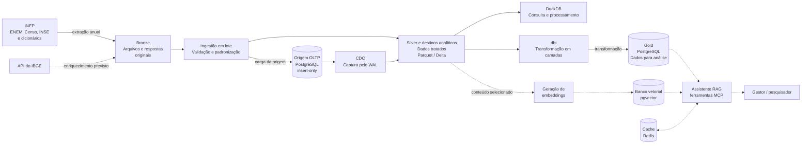
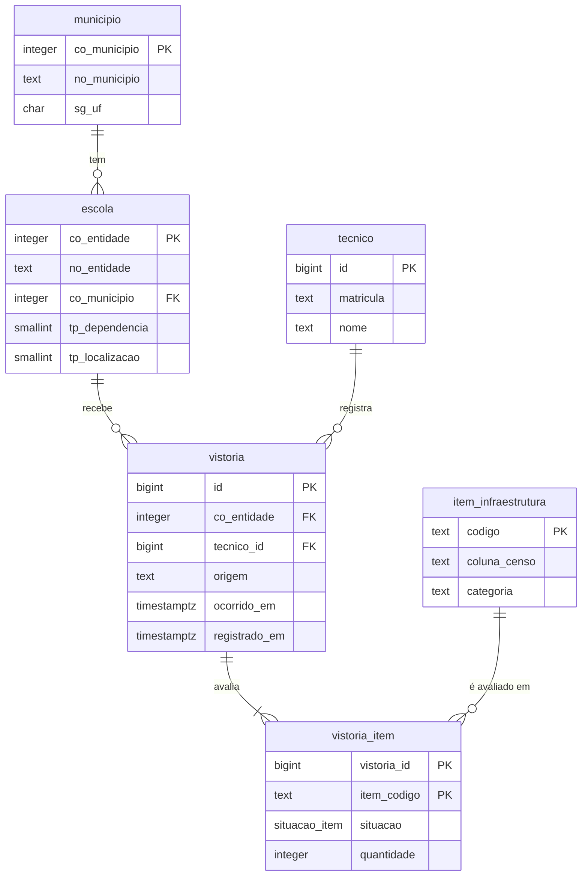

# EduInfra AI

Infraestrutura escolar e desempenho no ENEM. Projeto Integrado da Squad
EduInfra na disciplina Sistemas de Banco de Dados 2 (UnB/FCTE, 2026/2).

**O que o sistema faz:** mantém uma origem transacional de vistorias e um
pipeline analítico com ingestão do Censo e do ENEM, captura contínua de novas
vistorias, transformação da Gold pelo dbt e painel de análise. O Dagster
coordena o pipeline em lote, os testes de dados e a verificação de frescor.

**Problema que resolve:** reunir os dados públicos de infraestrutura e
desempenho por escola, com histórico, rastreabilidade e verificação de
qualidade, para apoiar a análise de gestores e pesquisadores. O assistente
RAG em linguagem natural integra a arquitetura prevista para a próxima entrega.

**Pergunta de gestão:** como a infraestrutura de uma escola se relaciona com
o desempenho dos seus alunos no ENEM? As comparações do painel são
associações observadas, sem interpretação causal ou controle de INSE.

## Arquitetura

A Bronze preserva os dados recebidos, a Silver contém dados validados e
padronizados e a Gold prepara os dados para consultas de negócio. O diagrama
é o mesmo da [página de arquitetura](docs/arquitetura.md), publicada no
[GitHub Pages](https://daviegito.github.io/bd2_2026_2_eduinfra/arquitetura/).
As setas pontilhadas representam integrações previstas.



Na E3, Censo e ENEM 2024 alimentam a análise por escola. A linha de base,
o CDC e as janelas mensais completam a fonte Delta canônica
`warehouse/eventos_vistoria`, pela chave `(vistoria_id, item_codigo)`. O dbt
consome um retrato dessa fonte e das Silver para construir a Gold no
PostgreSQL. O painel lê os fatos e dimensões da Gold.

INSE, IBGE, embeddings, busca vetorial, Redis e assistente RAG são componentes
previstos. O diagrama geral inclui essas partes futuras, enquanto o
[grafo do Dagster](docs/orquestracao.md) detalha as dependências executáveis
já implementadas.

| Componente | Responsabilidade | Tecnologia ou formato | Justificativa |
| --- | --- | --- | --- |
| Origem transacional | Armazenar escolas e vistorias de infraestrutura | PostgreSQL; vistorias insert-only | Garantir integridade e preservar o histórico das vistorias |
| Bronze | Preservar arquivos e respostas originais das fontes | Arquivos recebidos, como ZIP, CSV e JSON | Permitir rastreabilidade e reprocessamento |
| Ingestão em lote | Validar e padronizar os dados recebidos | Python | Controlar as cargas e evitar duplicações em reexecuções |
| CDC | Capturar novas vistorias pelo log do banco | WAL e slot lógico do PostgreSQL | Propagar mudanças e permitir retomada após interrupções |
| Silver | Armazenar dados tratados para análise | Parquet com compressão zstd e tabelas Delta | Permitir leitura colunar eficiente e, nas tabelas Delta, controle transacional |
| Consulta e processamento | Consultar e transformar os dados analíticos | DuckDB | Executar SQL diretamente sobre os arquivos, sem exigir um cluster |
| Transformação | Construir modelos em staging, intermediate e marts e executar testes de dados | dbt com PostgreSQL | Versionar SQL, dependências, documentação e contratos da Gold |
| Gold — camada de serviço | Disponibilizar fatos e dimensões para análise | PostgreSQL | Atender consultas estruturadas do painel |
| Orquestração | Coordenar dependências, agenda, retry, testes e frescor | Dagster | Registrar e acompanhar as execuções do pipeline |
| Painel | Explorar infraestrutura e desempenho por escola | HTML estático e Plotly | Disponibilizar a análise localmente e no GitHub Pages |
| Banco vetorial — previsto | Armazenar embeddings de conteúdos selecionados | pgvector | Permitir buscas por similaridade usando distância entre vetores |
| Cache — previsto | Reutilizar respostas e resultados válidos | Redis | Reduzir processamento repetido e tempo de resposta |

Bronze e Silver representam camadas de organização dos dados. Parquet é um formato de arquivo, e Delta acrescenta um log de transações aos arquivos Parquet. O DuckDB atua como mecanismo de consulta e processamento; ele não define, sozinho, um Data Lake.

Na arquitetura prevista, o assistente acessará os dados por ferramentas MCP. Perguntas numéricas, como “qual é a média do ENEM no DF entre escolas com e sem quadra?”, serão atendidas por consultas SQL aos dados modelados na Gold. Perguntas sobre similaridade, como “quais escolas têm perfil parecido com a escola X?”, poderão utilizar o pgvector.

O Redis poderá reutilizar resultados conforme as regras de validade e atualização do cache.

## Estado atual: Entrega 3

A E3 acrescenta a transformação, os testes e a orquestração da camada analítica:

- **ENEM 2024 na Silver**, agregado por escola, com manifesto por fonte e ano
  e [cobertura da junção com o Censo](docs/enem.md) medida;
- **Gold declarativa em dbt**, com dimensões, perfis históricos de infraestrutura
  e fatos de vistoria, infraestrutura anual e desempenho por escola/ano;
- **13 modelos e 26 testes dbt** na validação nacional registrada, com
  [comparação com SQL direto](docs/evidencias/issue-48/comparacao.md);
- **testes de dados da Gold**, cobrindo esquema, volume, unicidade, referências,
  distribuição e domínio, descritos em [Testes](docs/testes.md);
- **frescor da Gold com SLA de 25 horas**, medido contra os itens pendentes
  da origem, e [SLA do CDC de 60 segundos](docs/frescor-e-sla.md);
- **Dagster**, com grafo de dependências, agenda configurável, retry e
  [demonstrações registradas de retry e backfill](docs/orquestracao.md);
- **painel analítico** publicado no [GitHub Pages](https://daviegito.github.io/bd2_2026_2_eduinfra/painel.html),
  com perfil temporal da infraestrutura, cobertura e limites da comparação;
- **recuperação seletiva da fila do CDC**, com recibos e aceite explícito de
  desvios, conforme o [procedimento operacional](docs/metricas-cdc.md);
- **consulta otimizada**, com [planos e medições](docs/consulta-otimizada.md).

Na orquestração, ainda falta formalizar a comparação que levou ao Dagster e
registrar uma execução completa disparada pela agenda a partir de clone limpo
([issue #50](https://github.com/daviegito/bd2_2026_2_eduinfra/issues/50)). Os logs
existentes comprovam o retry e o backfill exercitados manualmente em ambiente
isolado. A disponibilidade da interface do Dagster não comprova esse aceite.

Da E2, permanecem implementados:

- **ingestão em lote idempotente**: cada execução fica registrada num manifesto
  com o SHA-256 do arquivo, e a Silver em Parquet é trocada inteira, só depois
  do commit no banco;
- **CDC pelo slot lógico** do PostgreSQL, com entrega no mínimo uma vez e
  efeito idempotente numa tabela Delta Lake;
- **dado atrasado** tratado em janelas mensais reprocessáveis, sem descarte;
- **camada analítica** em Delta Lake, particionada por ano do Censo e UF.

As decisões estão no [ADR 0004](docs/adr/0004-ingestao.md) e os detalhes na
seção "Ingestão e camada analítica (E2)", mais abaixo.

Da E1, que pedia uma fonte transacional modelada e populada com dado público:

- **origem de vistorias** em PostgreSQL 16, com esquema versionado em migrações
  Alembic;
- **modelo insert-only**: cada vistoria é um evento novo, com `ocorrido_em`
  (quando a realidade mudou na escola) separado de `registrado_em` (quando o dado
  entrou no banco). `UPDATE`, `DELETE` e `TRUNCATE` são bloqueados por gatilho
  ([ADR 0001](docs/adr/0001-modelagem-insert-only-do-sistema-de-origem.md));
- **carga reprodutível** do Censo Escolar 2024 com um comando: baixa o pacote do
  INEP, valida o cabeçalho e popula o banco como linha de base das vistorias;
- **carga idempotente**: rodar de novo não duplica nada.

### Modelo da origem



- `escola` e `municipio` são cadastro: vêm do Censo e só aceitam correção.
- `vistoria` e `vistoria_item` são eventos: só aceitam `INSERT`. Uma mudança na
  escola é uma vistoria nova, não a edição da anterior.
- `situacao` é um de `existente`, `inexistente`, `em_obra`, `inutilizavel` ou
  `nao_informado`. Um item não informado não apaga o que a vistoria anterior
  disse.
- `tecnico` é o único lugar com dado pessoal.
- A view `escola_estado_atual` pega, para cada escola e item, o evento mais
  recente.

## Como subir

Pré-requisitos:

- Docker com Docker Compose v2 (`docker compose`, sem hífen);
- acesso à internet para os pacotes oficiais e as imagens Docker. O Censo tem
  cerca de 34 MB compactados e o ENEM cerca de 526 MB;
- espaço em disco para os arquivos extraídos, o PostgreSQL, as tabelas Delta
  e o WAL. Os 445 MB registrados na E1 se referem apenas à origem daquela
  medição e não dimensionam o pipeline completo da E3.

O resto vem nas imagens: PostgreSQL 16 (`pgvector/pgvector:pg16`) e Python 3.12
com [uv](https://docs.astral.sh/uv/).

```bash
git clone https://github.com/daviegito/bd2_2026_2_eduinfra.git
cd bd2_2026_2_eduinfra
cp .env.example .env        # troque POSTGRES_PASSWORD e a senha em DATABASE_URL
docker compose up --build
```

O serviço `carga` roda as migrações, baixa e ingere o Censo 2024, publica a
linha de base nas tabelas Delta, imprime a caracterização da base e termina com
código 0. Em seguida, o serviço `cdc` sobe e fica consumindo o slot lógico a
cada 2 segundos. O `orquestrador` aguarda a carga e o CDC saudável e disponibiliza
o Dagster em <http://localhost:3000>. A agenda padrão é `0 3 * * *`, diariamente
às 3h no fuso `America/Sao_Paulo`, configurável por `AGENDA_ORQUESTRADOR`.

Para construir e testar imediatamente a Gold completa da E3, execute também:

```bash
docker compose run --build --rm transformacao
```

Esse serviço ingere o ENEM, prepara as fontes, executa `dbt build`, mede o
frescor e gera a documentação dbt. Na primeira execução, há download e
processamento dos dados nacionais; o tempo de 3 a 4 minutos medido na E1
não representa esse fluxo completo. A agenda posterior depende de manter o
serviço do Dagster em execução.

Se as portas estiverem ocupadas, ajuste `PORTA_POSTGRES` e `PORTA_DAGSTER`
no `.env`.

Para conferir a base populada:

```bash
docker compose exec banco psql -U eduinfra -d eduinfra \
  -c "select * from escola_estado_atual where co_entidade = 53002580;"
```

Para apagar tudo e começar do zero, inclusive o download em cache:

```bash
docker compose down -v
```

### Comandos da CLI

A imagem expõe a CLI `eduinfra`. Com o banco no ar:

| Comando | O que faz |
| --- | --- |
| `docker compose run --rm carga migrar` | aplica as migrações até a última revisão |
| `docker compose run --rm carga reverter --revisao 0003` | volta o esquema até a revisão indicada |
| `docker compose run --rm carga ingerir` | baixa o Censo, se preciso, e ingere; é idempotente e registra a execução no manifesto |
| `docker compose run --rm carga ingerir --forcar` | reexecuta mesmo que o arquivo já conste no manifesto (não duplica linhas) |
| `docker compose run --rm carga carregar` | sinônimo de `ingerir`, mantido por compatibilidade com a E1 |
| `docker compose run --rm carga ingerir-enem` | baixa o ENEM 2024, se preciso, e publica a Silver agregada por escola; idempotente pelo mesmo manifesto ([ENEM](docs/enem.md)) |
| `docker compose run --rm carga medir-cobertura-enem` | mede a junção das escolas do ENEM com as do Censo; `--saida` grava o resultado em Markdown |
| `docker compose run --rm carga caracterizar` | imprime contagens e tamanhos em disco, em Markdown |
| `docker compose run --rm carga comparar-compressao` | mede CSV e Parquet (sem compressão, snappy, zstd) sobre a camada Silver ([resultado](docs/serializacao-compressao.md)) |
| `docker compose run --rm carga processar-janelas` | reconcilia com a origem as janelas mensais tocadas pelas vistorias registradas desde a última execução, completando a fonte canônica de eventos ([dado atrasado](docs/dado-atrasado.md)) |
| `docker compose run --rm carga reprocessar-janela --mes AAAA-MM` | regrava a janela de um mês a partir da origem; idempotente |
| `docker compose run --rm carga demonstrar-atraso` | insere vistorias atrasadas e mostra em que janela cada uma cai |
| `docker compose run --rm carga publicar-analitico` | carrega a origem na tabela Delta e cria o slot lógico; idempotente |
| `docker compose run --rm carga cdc` | uma passada do consumidor do slot lógico (`--continuo` fica acompanhando) |
| `docker compose run --rm carga demonstrar-cdc` | demonstra o CDC, a retomada e a reentrega |
| `docker compose run --rm carga comparar-ingestao` | mede slot lógico contra recarga incremental |
| `docker compose run --rm carga publicar-analitica` | grava a tabela Delta da camada analítica e confere a contagem com o OLTP |
| `docker compose run --rm carga comparar-particionamento` | mede particionamento, compactação e evolução de esquema da tabela Delta ([resultado](docs/camada-analitica.md)) |
| `docker compose run --build --rm transformacao` | prepara Censo, ENEM e eventos canônicos, constrói e testa a Gold com dbt e gera sua documentação; fluxo completo da E3 |
| `docker compose run --rm carga construir-gold` | construtor SQL de infraestrutura, mantido para comparação com dbt; não entrega o fato ENEM exigido pelo painel |
| `docker compose run --no-deps --rm -v "$PWD/docs:/app/docs" carga gerar-painel` | exporta `docs/painel.html` a partir da Gold completa |
| `docker compose run --rm carga auditar-cdc` | confere consistência, fila, contrato e saúde do slot |
| `docker compose run --rm carga reprocessar-fila-cdc --responsavel operador-01 --motivo esquema_corrigido` | recupera os INSERTs rejeitados pela chave, mantendo itens inválidos pendentes e registrando recibos ([procedimento](docs/metricas-cdc.md)) |
| `docker compose run --rm carga comparar-granularidades` | mede os dois fatos (fino e largo) com a mesma pergunta; `--saida` grava o resultado em Markdown |
| `docker compose run --rm carga medir-frescor` | mede o frescor da Gold e registra em `monitoramento.frescor_gold`; sai com código 1 fora do SLA de 25 h (`--sla-horas` muda o limite); ver [frescor e SLA](docs/frescor-e-sla.md) |
| `docker compose run --rm carga demonstrar-frescor` | insere uma vistoria fora da Gold e mostra a violação do SLA |
| `docker compose run --rm carga tudo` | migrar, ingerir, publicar-analitico, caracterizar e publicar-analitica em sequência; é o padrão do compose |

Para rodar fora do Docker, com [uv](https://docs.astral.sh/uv/) e o banco do
compose publicado na porta do `.env`:

```bash
uv sync
set -a && source .env && set +a
uv run eduinfra tudo
```

## Transformações declarativas da Gold (E3, issue #48)

Depois de configurar `.env` a partir de `.env.example`, um comando prepara as
fontes reais, constrói e testa a Gold no PostgreSQL e gera o grafo dbt:

```bash
docker compose run --build --rm transformacao
```

O Compose executa a carga do Censo e aguarda o CDC saudável. O runner ingere o
ENEM 2024 pelo manifesto, fixa uma versão da fonte canônica Delta, publica as
sources em `entrada_transformacao` e roda `dbt build` e `dbt docs generate`.
A retenção do CDC é finita (2 GB por padrão), com verificação de margem e dreno
recente. O comando habitual da E2 continua disponível.

Os modelos ficam em `transformacao/models/{staging,intermediate,marts}`. Além
dos seis marts de infraestrutura, o fluxo completo publica
`gold.fato_desempenho_escola_ano`. Escolas do ENEM sem correspondência no Censo
ficam fora desse fato e são contabilizadas no resumo; a Silver original é
preservada e não há corte adicional em 30 participantes.

`DATA_REFERENCIA_ENEM=2024-11-03` define o ponto de corte da infraestrutura,
explicitamente parametrizado, sem tratá-lo como data individual da prova. O
modo parcial `--somente-infraestrutura` não atende ao aceite completo. O
construtor SQL `construir-gold` continua como opção nula para comparação.

Contratos, referência temporal, limites de publicação e exportação do grafo
interativo estão em [Transformação declarativa](docs/transformacao.md).
A [comparação com SQL direto e as evidências](docs/evidencias/issue-48/comparacao.md)
registram os tempos, os testes e a validação do fluxo completo.

## Painel analítico (E3, issue #53)

O [painel no GitHub Pages](https://daviegito.github.io/bd2_2026_2_eduinfra/painel.html)
é atualizado pelo workflow de documentação. Ele usa HTML estático e Plotly para
permitir interação no Pages, sem servidor de aplicação ou serviço pago.

Para gerar localmente com Censo, ENEM e eventos canônicos reais:

```bash
docker compose run --build --rm transformacao
docker compose run --no-deps --rm -v "$PWD/docs:/app/docs" carga gerar-painel
uv run mkdocs serve
```

Abra `http://127.0.0.1:8000/painel.html`. O arquivo gerado é `docs/painel.html`;
ele não é versionado. `construir-gold` sozinho só entrega a infraestrutura e
não substitui a transformação completa com ENEM exigida pelo painel.

A visualização seleciona `ANO_ENEM` (2024 por padrão) e usa o vínculo
`fato_desempenho_escola_ano.escola_infra_sk` com a dimensão SCD para comparar a
infraestrutura na referência analítica da prova. Os itens vêm do JSON `itens`
e seus nomes, do catálogo Gold. Estados desconhecidos, em obra e inutilizáveis
permanecem separados da ausência confirmada. O painel mostra média simples das
médias escolares válidas por rede/item, n e um desvio padrão; não estima efeito
causal nem controla INSE, que não está disponível neste contrato. Grupos com
menos de dez escolas com média válida são suprimidos e a regra é informada.

Os gráficos leem exclusivamente fatos e dimensões Gold. A cobertura completa
ENEM × Censo usa também o retrato `entrada_transformacao.enem_escola_ano`, pois
o fato Gold já exclui escolas sem correspondência. O total sem Censo e o total
com perfil temporal conhecido ficam explícitos, sem converter dados ausentes em
zero. O CI constrói a Gold real, testa o gerador, confere o HTML no site e publica
o mesmo artefato validado; ausência do painel ou de dados obrigatórios falha.

## O que a carga produz

Medido numa execução a partir de um clone limpo, em 26/09/2026, com o comando
`caracterizar`.

| Tabela | Linhas | O que guarda |
| --- | ---: | --- |
| `municipio` | 5.570 | municípios onde há escola em atividade |
| `escola` | 181.065 | escolas em atividade no Censo 2024 |
| `item_infraestrutura` | 17 | catálogo de itens vistoriados, com a coluna correspondente no Censo |
| `tecnico` | 1 | operador da carga automática; na operação real, os técnicos da secretaria |
| `vistoria` | 181.065 | uma vistoria de linha de base por escola, datada de 29/05/2024 |
| `vistoria_item` | 3.078.105 | a situação de cada item em cada vistoria |

`vistoria_item` ocupa 369 MB dos 445 MB do banco, somando dados e índices. É o
custo do modelo insert-only, discutido no
[ADR 0001](docs/adr/0001-modelagem-insert-only-do-sistema-de-origem.md). Cada
nova carga anual acrescenta perto de 3 milhões de linhas de item.

A escrita esperada do aplicativo da secretaria é de cerca de 500 vistorias por
dia, estimativa da Squad que ainda será medida. A leitura do estado atual de uma
escola deve ficar abaixo de 300 ms; medida com as estatísticas do banco
atualizadas, ela leva menos de 1 ms.

## Ingestão e camada analítica (E2)

A E2 leva o dado para a camada analítica por dois caminhos complementares,
decididos no [ADR 0004](docs/adr/0004-ingestao.md): a ingestão em lote do
Censo, idempotente, e a captura de mudanças (CDC) da origem pelo slot lógico do
PostgreSQL. O `docker compose up --build` de [Como subir](#como-subir) executa os
dois sem passo manual: o serviço `carga` faz a ingestão e a linha de base, e o
serviço `cdc` fica consumindo o slot depois que ela termina.

### Onde ficam os dados

Tudo fica no volume `dados_censo`, montado em `/dados` no contêiner. Fora do
Docker, o diretório é `dados/` na raiz do repositório (variável
`DIRETORIO_DADOS`).

| Caminho | Formato | Partição | Quem grava |
| --- | --- | --- | --- |
| `silver/ano_censo=AAAA/` | Parquet zstd | ano do Censo | `ingerir` (lote) |
| `silver/enem/ano=AAAA/` | Parquet zstd | ano do ENEM | `ingerir-enem` (lote) |
| `warehouse/vistoria_item/` | Delta Lake | `ano_censo` e `sg_uf` | `publicar-analitica` |
| `warehouse/eventos_vistoria/` | Delta Lake | mês de `ocorrido_em` | `publicar-analitico` (linha de base), serviço `cdc` e `processar-janelas` |
| `warehouse/eventos_vistoria_janelas.json` | JSON | — | `processar-janelas` e `reprocessar-janela` (controle das janelas) |

- `warehouse/vistoria_item` é a tabela da camada analítica, montada a partir da
  Silver: um registro por item de vistoria, já com escola e município.
- `warehouse/eventos_vistoria` é a **fonte canônica de eventos**
  ([ADR 0008](docs/adr/0008-fonte-canonica-de-eventos.md)): um registro por item de
  vistoria, com chave `(vistoria_id, item_codigo)`. A linha de base, o CDC e as
  janelas de dado atrasado gravam nela pelo mesmo merge, então um evento que
  chega por mais de um caminho aparece uma vez. A Gold lê só esta tabela.
- O antigo destino das janelas em Parquet, `analitico/eventos_vistoria/`, não é
  mais escrito nem lido e pode ser apagado.

Os comandos `demonstrar-cdc`, `demonstrar-atraso` e `comparar-ingestao` inserem
vistorias de teste na origem: rode-os num ambiente de desenvolvimento.

### Ingestão em lote idempotente

A versão vigente de uma fonte num ano é o SHA-256 do arquivo da última execução
registrada na tabela `ingestao_execucao` (o manifesto) para aquela fonte. A Silver publicada guarda o hash do
arquivo que a gerou em `origem.sha256`. A execução só é ignorada quando o
arquivo de origem coincide com **as duas** versões vigentes; por isso a sequência
A → B → A reprocessa a última execução em vez de ignorá-la.

Ordem de uma ingestão:

1. a Silver é montada num diretório de preparo em `_publicacao/`, fora de `silver/`;
2. o banco é carregado e a linha do manifesto é gravada na mesma transação;
3. confirmado o commit, a partição `silver/ano_censo=AAAA/` é trocada **inteira**
   (o diretório é renomeado, nunca arquivo a arquivo), então município, escola e
   itens são sempre da mesma versão.

Consequências: falha antes do commit deixa banco, manifesto e Silver como
estavam. Falha depois do commit deixa a Silver antiga; a próxima execução vê o
manifesto vigente com outra Silver, republica só a Silver e não recarrega o
banco. Uma queda entre os dois renames da troca é desfeita automaticamente na
execução seguinte. Entre os dois renames existe uma janela de microssegundos em
que a partição do ano não existe; um leitor nunca vê uma mistura de versões.

Se o arquivo de um ano já ingerido mudar (o INEP republicou), a partição Parquet
é substituída e o OLTP recebe apenas chaves novas: `vistoria` é insert-only
(ADR 0001), então corrigir um evento passado exige registrar uma nova vistoria.

```bash
docker compose exec banco psql -U eduinfra -d eduinfra \
  -c "select id, fonte, ano, left(hash_sha256, 12) as hash, forcada, escolas_inseridas, itens_inseridos, linhas_publicadas from ingestao_execucao order by id;"
```

### Ingestão do ENEM

O ENEM 2024 entra pelo mesmo protocolo: manifesto por SHA-256, Silver trocada
inteira depois do commit e reexecução ignorada. A migração `0008` acrescenta ao
manifesto a coluna `fonte` (`censo` ou `enem`) e renomeia `ano_censo` para `ano`.
Do pacote do INEP entra só `RESULTADOS_2024.csv`, o único arquivo com a escola e
as notas. A Silver tem uma linha por escola, com participantes, notas válidas e
médias por área e da redação.

```bash
docker compose run --rm carga migrar
docker compose run --rm carga ingerir-enem          # na primeira vez, baixa cerca de 526 MB
docker compose run --rm carga ingerir-enem          # repetir é ignorado pelo manifesto
docker compose run --rm carga medir-cobertura-enem  # precisa também da Silver do Censo
```

O `CO_ESCOLA` do ENEM junta com o `CO_ENTIDADE` do Censo em 100% das escolas de
código real. O INEP mascara o código das escolas com menos de 10 participantes,
que somam 14,4% das escolas e 1,4% dos participantes com escola. A medição, o
critério para ausentes, faltantes e nota zero e os limites estão em
[docs/enem.md](docs/enem.md). O ENEM não roda no `tudo`.

### Captura de mudanças pelo slot lógico

O serviço `banco` sobe com `wal_level=logical` e a migração `0005` publica
`vistoria` e `vistoria_item` na publicação `eduinfra_cdc`. O dado analítico fica
numa tabela Delta Lake, `eventos_vistoria`, em
`$DIRETORIO_DADOS/warehouse/eventos_vistoria` (volume `dados_censo` no Docker),
particionada pelo mês de `ocorrido_em`. O DuckDB lê com `delta_scan`.

```bash
docker compose run --rm carga publicar-analitico      # linha de base: origem -> Delta, idempotente
docker compose run --rm carga cdc                     # uma passada do consumidor do slot lógico
docker compose run --rm carga demonstrar-cdc          # insere na origem e mostra o efeito até o Delta
```

O serviço `cdc` do Compose roda o consumidor de forma contínua, a cada 2
segundos, depois que a carga termina. Para parar e retomar sem perder eventos:

```bash
docker compose stop cdc
docker compose start cdc
```

Mecanismo, semântica de entrega, demonstração e medições estão em
[docs/cdc-e-semantica-de-entrega.md](docs/cdc-e-semantica-de-entrega.md).

#### Confirmar o WAL lógico

O PostgreSQL de origem inicia com decodificação lógica habilitada. Para conferir
os parâmetros carregados pelo servidor:

```bash
docker compose exec banco psql -U eduinfra -d eduinfra \
  -c "SHOW wal_level;" \
  -c "SHOW max_replication_slots;" \
  -c "SHOW max_wal_senders;"
```

`wal_level` deve retornar `logical`. Para confirmar a publicação e suas tabelas:

```bash
docker compose exec banco psql -U eduinfra -d eduinfra \
  -c "SELECT pubname, pubinsert, pubupdate, pubdelete, pubtruncate
      FROM pg_publication
      WHERE pubname = 'eduinfra_cdc';" \
  -c "SELECT pubname, schemaname, tablename
      FROM pg_publication_tables
      WHERE pubname = 'eduinfra_cdc'
      ORDER BY schemaname, tablename;"
```

A publicação `eduinfra_cdc` inclui `public.vistoria` e
`public.vistoria_item`. Ambas usam `REPLICA IDENTITY DEFAULT`, isto é, suas
chaves primárias identificam linhas no WAL lógico. O modelo atual é insert-only,
mas a identidade por chave evita registrar a linha inteira e deixa a origem
preparada caso outros eventos sejam publicados no futuro.

### Dado atrasado em janelas mensais

A janela é o mês de `ocorrido_em`, a partição da fonte canônica de eventos.
`processar-janelas` pega as vistorias registradas desde a última execução,
reconcilia com a origem as janelas dos meses em que elas ocorreram e grava na
fonte só o que o CDC ainda não entregou. Uma vistoria que chega atrasada reabre
a janela do mês dela em vez de ser descartada, e reprocessar uma janela é
idempotente.

```bash
docker compose run --rm carga processar-janelas                  # janelas tocadas desde a última execução
docker compose run --rm carga demonstrar-atraso                  # insere vistorias atrasadas e mostra a janela de cada uma
docker compose run --rm carga reprocessar-janela --mes 2024-05   # reconcilia um mês com a origem
```

Margem, tolerância, reabertura e medições estão em
[docs/dado-atrasado.md](docs/dado-atrasado.md).

### Tabela Delta da camada analítica

A carga termina gravando uma tabela Delta, particionada por ano do Censo e UF,
com um registro por item de vistoria.
Critérios, medições e o que se perde estão em
[docs/camada-analitica.md](docs/camada-analitica.md).

| O quê | No contêiner | Fora do Docker |
| --- | --- | --- |
| Dados da tabela | `/dados/warehouse/vistoria_item/ano_censo=AAAA/sg_uf=UF/` | `dados/warehouse/vistoria_item/...` |
| Log de transações (catálogo) | `/dados/warehouse/vistoria_item/_delta_log/` | `dados/warehouse/vistoria_item/_delta_log/` |

Os dois ficam no volume `dados_censo`. Para consultar com o DuckDB:

```sql
install delta;
load delta;
select sg_uf, count(*) from delta_scan('dados/warehouse/vistoria_item') group by all;
```

## Orquestração (E3)

O serviço `orquestrador` sobe o [Dagster](https://docs.dagster.io/) em
<http://localhost:3000>, com o pipeline em lote agendado, retry e backfill.
A agenda padrão é diária às 3h, no horário de Brasília, e pode ser alterada
por `AGENDA_ORQUESTRADOR`. A Gold é construída pelo runner dbt e depois são
executados os testes da Gold e a medição de frescor. O backfill por mês atua
nas janelas da fonte de eventos; a Gold incorpora esse resultado na construção
seguinte. Detalhes, procedimentos e logs em
[docs/orquestracao.md](docs/orquestracao.md).

## Validar a E3

Com a Gold completa construída, execute a auditoria de dados:

```bash
docker compose run --no-deps --rm --entrypoint uv carga run --no-sync python -m unittest tests.test_e3_gold -v
```

Para os testes sem banco, com Python e uv disponíveis:

```bash
uv run --group dev --group transformacao --with hypothesis pytest -m "not integracao" -q
```

Os testes de integração exigem PostgreSQL descartável, configuração de WAL
lógico e os demais pré-requisitos de [docs/testes.md](docs/testes.md). Alguns
cenários inserem vistorias de propósito. A auditoria da Gold deve observar o
mesmo retrato de origem usado em sua construção.

| Evidência | Documento |
| --- | --- |
| Construção nacional, modelos, testes e comparação dbt × SQL | [Transformação da Gold](docs/evidencias/issue-48/comparacao.md) |
| Junção ENEM × Censo e códigos mascarados | [ENEM 2024](docs/enem.md) |
| Modelo dimensional, grãos e perfis históricos | [Modelo analítico](docs/modelo-analitico.md) |
| Limite de WAL durante a construção | [Retenção do CDC](docs/evidencias/issue-60/retencao-wal.md) |
| Retry e backfill exercitados | [Orquestração](docs/orquestracao.md#execucoes-registradas) |
| Recuperação seletiva e repetição idempotente | [Recuperação da fila CDC](docs/evidencias/issue-58/reprocessamento.md) |

## Estrutura do repositório

```
alembic/versions/   migrações do esquema, em ordem (0001 a 0009)
src/eduinfra/       CLI, download, ingestão, CDC e camada analítica
  microdados.py     download retomável do pacote do INEP
  tls.py            completa a cadeia de certificados do INEP (ADR 0002)
  transformacao.py  valida o cabeçalho e gera a Silver em Parquet
  carga.py          staging, consolidação idempotente e resumo
  ingestao.py       ingestão em lote idempotente, com manifesto (E2)
  enem.py           Silver do ENEM: resultados agregados por escola
  ingestao_enem.py  ingestão idempotente do ENEM, no mesmo manifesto
  cobertura_enem.py junção das escolas do ENEM com as do Censo
  cdc.py            leitura do slot de replicação lógica da origem
  pgoutput.py       decodificação das mensagens do plugin pgoutput
  fluxo_cdc.py      consumidor do CDC: do slot à tabela Delta de eventos
  eventos.py        tabela Delta de eventos de vistoria
  janelas.py        eventos em janelas mensais, com dado atrasado tratado
  camada_analitica.py tabela Delta da camada analítica e conferência com o OLTP
  caracterizacao.py contagens e tamanhos da base populada
  comparacao_*.py   medições citadas nos ADRs e em docs/
  demonstracao_*.py demonstrações do CDC e do dado atrasado
  orquestrador.py   pipeline em lote, agenda, retry e backfill no Dagster
  fontes_transformacao.py prepara e confere as sources PostgreSQL do dbt
  modelo_analitico.py construtor SQL e consultas de comparação
  frescor.py        medição do SLA da Gold
  painel.py         geração do painel HTML a partir da Gold
  auditoria_cdc.py  conferência da origem, Delta, fila e slot
  recuperacao_cdc.py reprocessamento seletivo e recibos do CDC
transformacao/      projeto dbt: modelos, contratos, testes e runners
tests/              testes unitários e de integração (ver docs/testes.md)
docs/               guias, decisões e evidências da E1, E2 e E3
docs/adr/           registros de decisão de arquitetura
docs/diario/        diário de bordo semanal
docker-compose.yml  PostgreSQL, carga, CDC, transformação dbt e Dagster
Dockerfile          imagem da carga, com uv
.env.example        variáveis de ambiente; copie para .env
AI-USAGE.md         registro de uso de IA
```

## Documentação do processo

| Documento | Onde | Estado |
| --- | --- | --- |
| Decisões de arquitetura | [docs/adr/](docs/adr/README.md) | ADRs 0001, 0002, 0004 e 0007 aceitos; 0005 e 0008 propostos; 0003 e 0006 a escrever |
| Diário de bordo semanal | [docs/diario/diario-de-bordo.md](docs/diario/diario-de-bordo.md) | Semanas 1 a 10, atualizado a cada Semana |
| Registro de uso de IA | [AI-USAGE.md](AI-USAGE.md) | E1, E2 e E3, atualizado a cada uso |

## Fontes de dados

| Fonte | Quem gera | Papel no projeto |
| --- | --- | --- |
| [Microdados do ENEM 2024](https://www.gov.br/inep/pt-br/acesso-a-informacao/dados-abertos/microdados/enem) | INEP | desempenho (variável dependente) |
| [Microdados do Censo Escolar 2024](https://www.gov.br/inep/pt-br/acesso-a-informacao/dados-abertos/microdados/censo-escolar) | INEP | infraestrutura (variável independente) e carga da origem |
| Indicador de Nível Socioeconômico (INSE) | INEP | controle socioeconômico das comparações |
| API do IBGE | IBGE | contexto regional do município da escola |
| Dicionários de variáveis | INEP | metadados da camada semântica e do RAG |
| Histórico de interação (prompts) | o próprio assistente | uso da plataforma |
| Sistema de vistorias | aplicativo da secretaria | origem transacional (OLTP) |

Na E3, Censo e ENEM 2024 estão integrados. INSE e IBGE permanecem previstos,
portanto as comparações atuais não controlam o nível socioeconômico. O histórico
de interação será produzido quando o assistente estiver implementado.

O código `CO_ESCOLA` do ENEM 2024 permite a junção com o Censo no grão escola.
Na medição registrada, 25.179 das 29.400 escolas da entrada foram encontradas
no Censo (85,6%). As 4.221 restantes têm código mascarado pelo INEP por terem
menos de dez participantes. Isso corresponde a 100% de junção entre os códigos
reais. Critérios de notas, participantes e cobertura em [ENEM](docs/enem.md).

Os microdados do INEP são anonimizados na origem. Na E1, o único dado pessoal é o
do técnico que registra a vistoria, na tabela `tecnico`, e ele não sai da origem
sem pseudonimização.

## Decisões de arquitetura

| ADR | Decisão |
| --- | --- |
| [0001](docs/adr/0001-modelagem-insert-only-do-sistema-de-origem.md) | Esquema insert-only com carimbo de tempo do evento na origem |
| [0002](docs/adr/0002-cadeia-tls-incompleta-do-inep.md) | Completar a cadeia TLS do INEP por AIA em vez de relaxar a verificação |
| [0004](docs/adr/0004-ingestao.md) | Combinar lote idempotente do Censo com CDC pelo slot lógico do PostgreSQL |
| [0005](docs/adr/0005-ferramenta-de-transformacao.md) | Usar dbt para as transformações da Gold; status proposto |
| [0007](docs/adr/0007-telemetria-e-fila-de-erros-do-cdc.md) | Telemetria transacional, fila de erros e tratamento das ocorrências do CDC |
| [0008](docs/adr/0008-fonte-canonica-de-eventos.md) | Fonte Delta única de eventos para linha de base, CDC e janelas; status proposto |

## Entregas

| Entrega | Tema | Data prevista |
| --- | --- | --- |
| E1 | Fonte transacional modelada e populada | 28/09/2026 |
| E2 | Ingestão em lote e captura de mudanças | 19/10/2026 |
| E3 | Camada analítica transformada, testada e orquestrada | 03/11/2026 |
| E4 | Plataforma completa, governada e defendida | 24/11/2026 |

Datas do [cronograma da disciplina](https://unb-bd2.github.io/PlanoEnsino/cronograma/),
ainda provisórias.

## Equipe

| Integrante | GitHub |
| --- | --- |
| Artur Mendonça Arruda | [@ArtyMend07](https://github.com/ArtyMend07) |
| Davi Coelho | [@daviegito](https://github.com/daviegito) |
| Gabriel Lopes de Amorim | [@BrzGab](https://github.com/BrzGab) |
| Lucas Mendonça Arruda | [@lucasarruda9](https://github.com/lucasarruda9) |
| Marcos Vinícius | [@MarcosViniciusG](https://github.com/MarcosViniciusG) |
| Pedro Sanchez | [@PedroDev-sketch](https://github.com/PedroDev-sketch) |
| Pedro Vargas | [@Pedrovargas10](https://github.com/Pedrovargas10) |

## Licença

[GPL-3.0](LICENSE).
