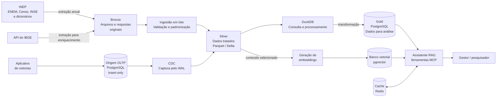
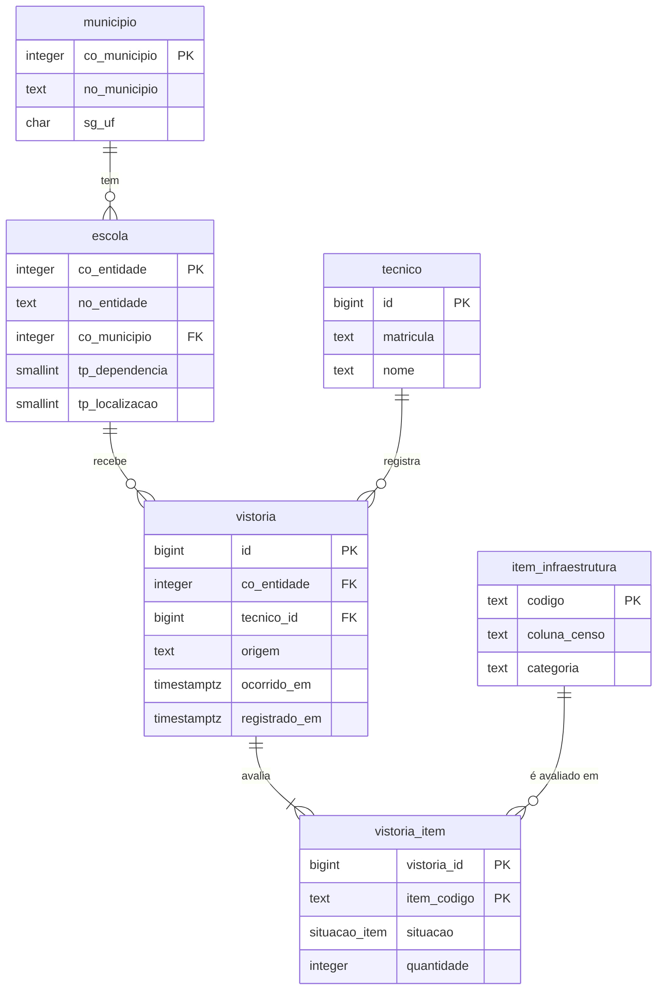

# EduInfra AI

Assistente RAG de infraestrutura escolar e desempenho no ENEM. Projeto
Integrado da Squad EduInfra na disciplina Sistemas de Banco de Dados 2
(UnB/FCTE, 2026/2).

**O que o sistema faz:** um sistema transacional (OLTP) de vistorias de
infraestrutura escolar, acoplado a um pipeline analítico e a um banco vetorial
que alimentam um assistente RAG.

**Problema que resolve:** extrair respostas rápidas e visuais dos microdados do
ENEM e do Censo Escolar exige, hoje, conhecimento técnico de SQL e de engenharia
de dados. O EduInfra AI permite que gestores educacionais e pesquisadores façam
essas perguntas em linguagem natural, pelo chat.

**Pergunta de gestão:** a infraestrutura de uma escola se reflete no desempenho
dos seus alunos no ENEM?

## Arquitetura

O dado passa por três estágios: o armazenamento bruto (Bronze e Silver), a
camada de serviço (Gold) e o consumo pelo assistente.



Até a E2, estão implementadas a origem OLTP, a ingestão do Censo para a Silver e
a captura de mudanças da origem para a camada analítica em Delta Lake. Gold,
banco vetorial, cache e assistente chegam nas próximas entregas.

| Estágio | O que guarda | Tecnologia | Por quê |
| --- | --- | --- | --- |
| Origem transacional | vistorias de infraestrutura registradas pela secretaria | PostgreSQL, insert-only | escrita concorrente com integridade forte, sem apagar o histórico da escola |
| Bronze e Silver (Data Lake) | microdados do INEP convertidos para formato colunar | Parquet (zstd) + DuckDB | a análise lê poucas colunas de milhões de linhas; DuckDB faz isso numa máquina só, sem cluster |
| Gold (Serving e Camada Semântica) | tabela fato escola × desempenho, pronta para consulta | PostgreSQL | o assistente e o painel precisam de respostas exatas e rápidas, por chave e com filtro |
| Banco vetorial | embeddings das escolas e do dicionário de variáveis | pgvector | a busca por escolas parecidas é distância entre vetores, não SQL |
| Cache semântico | respostas e gráficos já gerados | Redis | a mesma pergunta não gasta latência nem tokens duas vezes |

O assistente responde por ferramentas MCP. Perguntas numéricas ("gere um gráfico
da média do ENEM no DF comparando quem tem e quem não tem quadra") viram SQL
exato no PostgreSQL. Perguntas abstratas ("quais escolas têm perfil parecido com
a escola X?") vão para a busca por similaridade no banco vetorial.

## Estado atual: Entrega 2

A E2 pede ingestão em lote e captura de mudanças sobre a origem da E1. Este
repositório entrega, além da E1:

- **ingestão em lote idempotente**: cada execução fica registrada num manifesto
  com o SHA-256 do arquivo, e a Silver em Parquet é trocada inteira, só depois
  do commit no banco;
- **CDC pelo slot lógico** do PostgreSQL, com entrega no mínimo uma vez e
  efeito idempotente numa tabela Delta Lake;
- **dado atrasado** tratado em janelas mensais reprocessáveis, sem descarte;
- **camada analítica** em Delta Lake, particionada por ano do Censo e UF.

As decisões estão no [ADR 0004](docs/adr/0004-ingestao.md) e os detalhes na
seção "Ingestão e camada analítica (E2)", mais abaixo.

Da E1, que pedia uma fonte transacional modelada e populada com dado público:

- **origem de vistorias** em PostgreSQL 16, com esquema versionado em migrações
  Alembic;
- **modelo insert-only**: cada vistoria é um evento novo, com `ocorrido_em`
  (quando a realidade mudou na escola) separado de `registrado_em` (quando o dado
  entrou no banco). `UPDATE`, `DELETE` e `TRUNCATE` são bloqueados por gatilho
  ([ADR 0001](docs/adr/0001-modelagem-insert-only-do-sistema-de-origem.md));
- **carga reprodutível** do Censo Escolar 2024 com um comando: baixa o pacote do
  INEP, valida o cabeçalho e popula o banco como linha de base das vistorias;
- **carga idempotente**: rodar de novo não duplica nada.

### Modelo da origem



- `escola` e `municipio` são cadastro: vêm do Censo e só aceitam correção.
- `vistoria` e `vistoria_item` são eventos: só aceitam `INSERT`. Uma mudança na
  escola é uma vistoria nova, não a edição da anterior.
- `situacao` é um de `existente`, `inexistente`, `em_obra`, `inutilizavel` ou
  `nao_informado`. Um item não informado não apaga o que a vistoria anterior
  disse.
- `tecnico` é o único lugar com dado pessoal.
- A view `escola_estado_atual` pega, para cada escola e item, o evento mais
  recente.

## Como subir

Pré-requisitos:

- Docker com Docker Compose v2 (`docker compose`, sem hífen);
- acesso à internet, porque a carga baixa cerca de 34 MB do INEP;
- cerca de 1 GB livre em disco: o banco ocupa 445 MB depois de populado.

O resto vem nas imagens: PostgreSQL 16 (`pgvector/pgvector:pg16`) e Python 3.12
com [uv](https://docs.astral.sh/uv/).

```bash
git clone https://github.com/daviegito/bd2_2026_2_eduinfra.git
cd bd2_2026_2_eduinfra
cp .env.example .env        # troque POSTGRES_PASSWORD e a senha em DATABASE_URL
docker compose up --build
```

O serviço `carga` roda as migrações, baixa e ingere o Censo 2024, publica a
linha de base nas tabelas Delta, imprime a caracterização da base e termina com
código 0. Em seguida, o serviço `cdc` sobe e fica consumindo o slot lógico a
cada 2 segundos. Os serviços `banco` e `cdc` continuam no ar. Na E1, numa
máquina limpa, o processo levava de 3 a 4 minutos.

Se a porta 5432 já estiver em uso, mude `PORTA_POSTGRES` no `.env`.

Para conferir a base populada:

```bash
docker compose exec banco psql -U eduinfra -d eduinfra \
  -c "select * from escola_estado_atual where co_entidade = 53002580;"
```

Para apagar tudo e começar do zero, inclusive o download em cache:

```bash
docker compose down -v
```

### Comandos da CLI

A imagem expõe a CLI `eduinfra`. Com o banco no ar:

| Comando | O que faz |
| --- | --- |
| `docker compose run --rm carga migrar` | aplica as migrações até a última revisão |
| `docker compose run --rm carga reverter --revisao 0003` | volta o esquema até a revisão indicada |
| `docker compose run --rm carga ingerir` | baixa o Censo, se preciso, e ingere; é idempotente e registra a execução no manifesto |
| `docker compose run --rm carga ingerir --forcar` | reexecuta mesmo que o arquivo já conste no manifesto (não duplica linhas) |
| `docker compose run --rm carga carregar` | sinônimo de `ingerir`, mantido por compatibilidade com a E1 |
| `docker compose run --rm carga caracterizar` | imprime contagens e tamanhos em disco, em Markdown |
| `docker compose run --rm carga comparar-compressao` | mede CSV e Parquet (sem compressão, snappy, zstd) sobre a camada Silver ([resultado](docs/serializacao-compressao.md)) |
| `docker compose run --rm carga processar-janelas` | leva à camada analítica as vistorias registradas desde a última execução, em janelas mensais ([dado atrasado](docs/dado-atrasado.md)) |
| `docker compose run --rm carga reprocessar-janela --mes AAAA-MM` | regrava a janela de um mês a partir da origem; idempotente |
| `docker compose run --rm carga demonstrar-atraso` | insere vistorias atrasadas e mostra em que janela cada uma cai |
| `docker compose run --rm carga publicar-analitico` | carrega a origem na tabela Delta e cria o slot lógico; idempotente |
| `docker compose run --rm carga cdc` | uma passada do consumidor do slot lógico (`--continuo` fica acompanhando) |
| `docker compose run --rm carga demonstrar-cdc` | demonstra o CDC, a retomada e a reentrega |
| `docker compose run --rm carga comparar-ingestao` | mede slot lógico contra recarga incremental |
| `docker compose run --rm carga publicar-analitica` | grava a tabela Delta da camada analítica e confere a contagem com o OLTP |
| `docker compose run --rm carga comparar-particionamento` | mede particionamento, compactação e evolução de esquema da tabela Delta ([resultado](docs/camada-analitica.md)) |
| `docker compose run --rm carga tudo` | migrar, ingerir, publicar-analitico, caracterizar e publicar-analitica em sequência; é o padrão do compose |

Para rodar fora do Docker, com [uv](https://docs.astral.sh/uv/) e o banco do
compose publicado na porta do `.env`:

```bash
uv sync
set -a && source .env && set +a
uv run eduinfra tudo
```

## O que a carga produz

Medido numa execução a partir de um clone limpo, em 26/09/2026, com o comando
`caracterizar`.

| Tabela | Linhas | O que guarda |
| --- | ---: | --- |
| `municipio` | 5.570 | municípios onde há escola em atividade |
| `escola` | 181.065 | escolas em atividade no Censo 2024 |
| `item_infraestrutura` | 17 | catálogo de itens vistoriados, com a coluna correspondente no Censo |
| `tecnico` | 1 | operador da carga automática; na operação real, os técnicos da secretaria |
| `vistoria` | 181.065 | uma vistoria de linha de base por escola, datada de 29/05/2024 |
| `vistoria_item` | 3.078.105 | a situação de cada item em cada vistoria |

`vistoria_item` ocupa 369 MB dos 445 MB do banco, somando dados e índices. É o
custo do modelo insert-only, discutido no
[ADR 0001](docs/adr/0001-modelagem-insert-only-do-sistema-de-origem.md). Cada
nova carga anual acrescenta perto de 3 milhões de linhas de item.

A escrita esperada do aplicativo da secretaria é de cerca de 500 vistorias por
dia, estimativa da Squad que ainda será medida. A leitura do estado atual de uma
escola deve ficar abaixo de 300 ms; medida com as estatísticas do banco
atualizadas, ela leva menos de 1 ms.

## Ingestão e camada analítica (E2)

A E2 leva o dado para a camada analítica por dois caminhos complementares,
decididos no [ADR 0004](docs/adr/0004-ingestao.md): a ingestão em lote do
Censo, idempotente, e a captura de mudanças (CDC) da origem pelo slot lógico do
PostgreSQL. O `docker compose up --build` de [Como subir](#como-subir) executa os
dois sem passo manual: o serviço `carga` faz a ingestão e a linha de base, e o
serviço `cdc` fica consumindo o slot depois que ela termina.

### Onde ficam os dados

Tudo fica no volume `dados_censo`, montado em `/dados` no contêiner. Fora do
Docker, o diretório é `dados/` na raiz do repositório (variável
`DIRETORIO_DADOS`).

| Caminho | Formato | Partição | Quem grava |
| --- | --- | --- | --- |
| `silver/ano_censo=AAAA/` | Parquet zstd | ano do Censo | `ingerir` (lote) |
| `warehouse/vistoria_item/` | Delta Lake | `ano_censo` e `sg_uf` | `publicar-analitica` |
| `warehouse/eventos_vistoria/` | Delta Lake | mês de `ocorrido_em` | `publicar-analitico` (linha de base) e serviço `cdc` |
| `analitico/eventos_vistoria/` | Parquet zstd | `ocorrido_mes=AAAA-MM` | `processar-janelas` (não roda no `tudo`) |

- `warehouse/vistoria_item` é a tabela da camada analítica, montada a partir da
  Silver: um registro por item de vistoria, já com escola e município.
- `warehouse/eventos_vistoria` recebe da origem, pelo CDC, cada item de vistoria
  confirmado no banco.
- `analitico/eventos_vistoria` é o caminho de dado atrasado em janelas mensais.
  Ele coexiste com o CDC; a unificação dos dois destinos ainda não está
  implementada (ADR 0004).

Os comandos `demonstrar-cdc`, `demonstrar-atraso` e `comparar-ingestao` inserem
vistorias de teste na origem: rode-os num ambiente de desenvolvimento.

### Ingestão em lote idempotente

A versão vigente de um ano é o SHA-256 do arquivo da última execução registrada
na tabela `ingestao_execucao` (o manifesto). A Silver publicada guarda o hash do
arquivo que a gerou em `origem.sha256`. A execução só é ignorada quando o
arquivo de origem coincide com **as duas** versões vigentes; por isso a sequência
A → B → A reprocessa a última execução em vez de ignorá-la.

Ordem de uma ingestão:

1. a Silver é montada num diretório de preparo em `_publicacao/`, fora de `silver/`;
2. o banco é carregado e a linha do manifesto é gravada na mesma transação;
3. confirmado o commit, a partição `silver/ano_censo=AAAA/` é trocada **inteira**
   (o diretório é renomeado, nunca arquivo a arquivo), então município, escola e
   itens são sempre da mesma versão.

Consequências: falha antes do commit deixa banco, manifesto e Silver como
estavam. Falha depois do commit deixa a Silver antiga; a próxima execução vê o
manifesto vigente com outra Silver, republica só a Silver e não recarrega o
banco. Uma queda entre os dois renames da troca é desfeita automaticamente na
execução seguinte. Entre os dois renames existe uma janela de microssegundos em
que a partição do ano não existe; um leitor nunca vê uma mistura de versões.

Se o arquivo de um ano já ingerido mudar (o INEP republicou), a partição Parquet
é substituída e o OLTP recebe apenas chaves novas: `vistoria` é insert-only
(ADR 0001), então corrigir um evento passado exige registrar uma nova vistoria.

```bash
docker compose exec banco psql -U eduinfra -d eduinfra \
  -c "select id, ano_censo, left(hash_sha256, 12) as hash, forcada, escolas_inseridas, itens_inseridos from ingestao_execucao order by id;"
```

### Captura de mudanças pelo slot lógico

O serviço `banco` sobe com `wal_level=logical` e a migração `0005` publica
`vistoria` e `vistoria_item` na publicação `eduinfra_cdc`. O dado analítico fica
numa tabela Delta Lake, `eventos_vistoria`, em
`$DIRETORIO_DADOS/warehouse/eventos_vistoria` (volume `dados_censo` no Docker),
particionada pelo mês de `ocorrido_em`. O DuckDB lê com `delta_scan`.

```bash
docker compose run --rm carga publicar-analitico      # linha de base: origem -> Delta, idempotente
docker compose run --rm carga cdc                     # uma passada do consumidor do slot lógico
docker compose run --rm carga demonstrar-cdc          # insere na origem e mostra o efeito até o Delta
```

O serviço `cdc` do Compose roda o consumidor de forma contínua, a cada 2
segundos, depois que a carga termina. Para parar e retomar sem perder eventos:

```bash
docker compose stop cdc
docker compose start cdc
```

Mecanismo, semântica de entrega, demonstração e medições estão em
[docs/cdc-e-semantica-de-entrega.md](docs/cdc-e-semantica-de-entrega.md).

#### Confirmar o WAL lógico

O PostgreSQL de origem inicia com decodificação lógica habilitada. Para conferir
os parâmetros carregados pelo servidor:

```bash
docker compose exec banco psql -U eduinfra -d eduinfra \
  -c "SHOW wal_level;" \
  -c "SHOW max_replication_slots;" \
  -c "SHOW max_wal_senders;"
```

`wal_level` deve retornar `logical`. Para confirmar a publicação e suas tabelas:

```bash
docker compose exec banco psql -U eduinfra -d eduinfra \
  -c "SELECT pubname, pubinsert, pubupdate, pubdelete, pubtruncate
      FROM pg_publication
      WHERE pubname = 'eduinfra_cdc';" \
  -c "SELECT pubname, schemaname, tablename
      FROM pg_publication_tables
      WHERE pubname = 'eduinfra_cdc'
      ORDER BY schemaname, tablename;"
```

A publicação `eduinfra_cdc` inclui `public.vistoria` e
`public.vistoria_item`. Ambas usam `REPLICA IDENTITY DEFAULT`, isto é, suas
chaves primárias identificam linhas no WAL lógico. O modelo atual é insert-only,
mas a identidade por chave evita registrar a linha inteira e deixa a origem
preparada caso outros eventos sejam publicados no futuro.

### Dado atrasado em janelas mensais

`processar-janelas` leva à camada analítica as vistorias registradas desde a
última execução, agrupadas pelo mês em que ocorreram. Uma vistoria que chega
atrasada reabre a janela do mês dela em vez de ser descartada, e reprocessar uma
janela é idempotente.

```bash
docker compose run --rm carga processar-janelas                  # janelas tocadas desde a última execução
docker compose run --rm carga demonstrar-atraso                  # insere vistorias atrasadas e mostra a janela de cada uma
docker compose run --rm carga reprocessar-janela --mes 2024-05   # regrava um mês a partir da origem
```

Margem, tolerância, reabertura e medições estão em
[docs/dado-atrasado.md](docs/dado-atrasado.md).

### Tabela Delta da camada analítica

A carga termina gravando uma tabela Delta, particionada por ano do Censo e UF,
com um registro por item de vistoria.
Critérios, medições e o que se perde estão em
[docs/camada-analitica.md](docs/camada-analitica.md).

| O quê | No contêiner | Fora do Docker |
| --- | --- | --- |
| Dados da tabela | `/dados/warehouse/vistoria_item/ano_censo=AAAA/sg_uf=UF/` | `dados/warehouse/vistoria_item/...` |
| Log de transações (catálogo) | `/dados/warehouse/vistoria_item/_delta_log/` | `dados/warehouse/vistoria_item/_delta_log/` |

Os dois ficam no volume `dados_censo`. Para consultar com o DuckDB:

```sql
install delta;
load delta;
select sg_uf, count(*) from delta_scan('dados/warehouse/vistoria_item') group by all;
```

## Estrutura do repositório

```
alembic/versions/   migrações do esquema, em ordem (0001 a 0006)
src/eduinfra/       CLI, download, ingestão, CDC e camada analítica
  microdados.py     download retomável do pacote do INEP
  tls.py            completa a cadeia de certificados do INEP (ADR 0002)
  transformacao.py  valida o cabeçalho e gera a Silver em Parquet
  carga.py          staging, consolidação idempotente e resumo
  ingestao.py       ingestão em lote idempotente, com manifesto (E2)
  cdc.py            leitura do slot de replicação lógica da origem
  pgoutput.py       decodificação das mensagens do plugin pgoutput
  fluxo_cdc.py      consumidor do CDC: do slot à tabela Delta de eventos
  eventos.py        tabela Delta de eventos de vistoria
  janelas.py        eventos em janelas mensais, com dado atrasado tratado
  camada_analitica.py tabela Delta da camada analítica e conferência com o OLTP
  caracterizacao.py contagens e tamanhos da base populada
  comparacao_*.py   medições citadas nos ADRs e em docs/
  demonstracao_*.py demonstrações do CDC e do dado atrasado
tests/              testes unitários e de integração (ver docs/testes.md)
docs/               medições e decisões de cada tema da E2
docs/adr/           registros de decisão de arquitetura
docs/diario/        diário de bordo semanal
docker-compose.yml  banco PostgreSQL, serviço de carga e consumidor do CDC
Dockerfile          imagem da carga, com uv
.env.example        variáveis de ambiente; copie para .env
AI-USAGE.md         registro de uso de IA
```

## Documentação do processo

| Documento | Onde | Estado |
| --- | --- | --- |
| Decisões de arquitetura | [docs/adr/](docs/adr/README.md) | ADRs 0001, 0002 e 0004; 0003, 0005 e 0006 a escrever |
| Diário de bordo semanal | [docs/diario/diario-de-bordo.md](docs/diario/diario-de-bordo.md) | Semanas 1 a 10, atualizado a cada Semana |
| Registro de uso de IA | [AI-USAGE.md](AI-USAGE.md) | E1 e E2, atualizado a cada uso |

## Fontes de dados

| Fonte | Quem gera | Papel no projeto |
| --- | --- | --- |
| [Microdados do ENEM 2024](https://www.gov.br/inep/pt-br/acesso-a-informacao/dados-abertos/microdados/enem) | INEP | desempenho (variável dependente) |
| [Microdados do Censo Escolar 2024](https://www.gov.br/inep/pt-br/acesso-a-informacao/dados-abertos/microdados/censo-escolar) | INEP | infraestrutura (variável independente) e carga da origem |
| Indicador de Nível Socioeconômico (INSE) | INEP | controle socioeconômico das comparações |
| API do IBGE | IBGE | contexto regional do município da escola |
| Dicionários de variáveis | INEP | metadados da camada semântica e do RAG |
| Histórico de interação (prompts) | o próprio assistente | uso da plataforma |
| Sistema de vistorias | aplicativo da secretaria | origem transacional (OLTP) |

O projeto usa o ENEM de 2024 porque é a edição em que o INEP devolveu o código
da escola aos microdados, o que permite cruzar desempenho e infraestrutura no
grão escola.

Os microdados do INEP são anonimizados na origem. Na E1, o único dado pessoal é o
do técnico que registra a vistoria, na tabela `tecnico`, e ele não sai da origem
sem pseudonimização.

## Decisões de arquitetura

| ADR | Decisão |
| --- | --- |
| [0001](docs/adr/0001-modelagem-insert-only-do-sistema-de-origem.md) | Esquema insert-only com carimbo de tempo do evento na origem |
| [0002](docs/adr/0002-cadeia-tls-incompleta-do-inep.md) | Completar a cadeia TLS do INEP por AIA em vez de relaxar a verificação |
| [0004](docs/adr/0004-ingestao.md) | Combinar lote idempotente do Censo com CDC pelo slot lógico do PostgreSQL |

## Entregas

| Entrega | Tema | Data prevista |
| --- | --- | --- |
| E1 | Fonte transacional modelada e populada | 28/09/2026 |
| E2 | Ingestão em lote e captura de mudanças | 19/10/2026 |
| E3 | Camada analítica transformada, testada e orquestrada | 03/11/2026 |
| E4 | Plataforma completa, governada e defendida | 24/11/2026 |

Datas do [cronograma da disciplina](https://unb-bd2.github.io/Disciplina/cronograma/),
ainda provisórias.

## Equipe

| Integrante | GitHub |
| --- | --- |
| Artur Mendonça Arruda | [@ArtyMend07](https://github.com/ArtyMend07) |
| Davi Coelho | [@daviegito](https://github.com/daviegito) |
| Gabriel Lopes de Amorim | [@BrzGab](https://github.com/BrzGab) |
| Lucas Mendonça Arruda | [@lucasarruda9](https://github.com/lucasarruda9) |
| Marcos Vinícius | [@MarcosViniciusG](https://github.com/MarcosViniciusG) |
| Pedro Sanchez | [@PedroDev-sketch](https://github.com/PedroDev-sketch) |
| Pedro Vargas | [@Pedrovargas10](https://github.com/Pedrovargas10) |

## Licença

[GPL-3.0](LICENSE).
