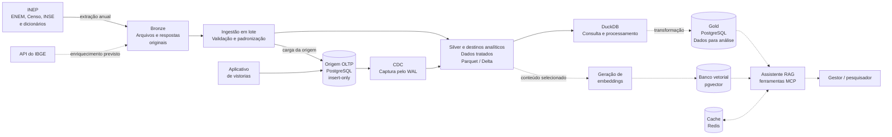

# Arquitetura

A Bronze preserva os dados recebidos; a Silver contém dados validados e
padronizados; e a Gold prepara os dados para consultas de negócio. O diagrama
mostra a arquitetura geral proposta, incluindo integrações e componentes futuros.

*Deslize o diagrama horizontalmente para ver o fluxo completo.*

As setas pontilhadas indicam caminhos previstos. Das fontes do INEP, somente o
Censo está integrado até a E2. O aplicativo representa o produtor previsto das
vistorias; a origem PostgreSQL já pode receber esses registros.

| Componente | Responsabilidade | Tecnologia ou formato |
| --- | --- | --- |
| Origem transacional | Armazenar escolas e preservar o histórico das vistorias | PostgreSQL 16; vistorias insert-only |
| Bronze | Preservar os arquivos recebidos para rastreabilidade e reprocessamento | ZIP e CSV do Censo; demais fontes previstas |
| Ingestão em lote | Validar, padronizar e controlar reexecuções por ano | Python, SHA-256 e manifesto no PostgreSQL |
| CDC | Capturar inserções pelo log do banco e confirmar a leitura após gravar no destino | WAL, slot lógico e consumidor Python |
| Silver e destinos analíticos | Armazenar dados tratados para análise | Parquet com zstd e tabelas Delta |
| Consulta e processamento | Executar SQL sobre os dados analíticos | DuckDB |
| Gold — prevista | Disponibilizar dados modelados e indicadores | PostgreSQL |
| Banco vetorial — previsto | Armazenar embeddings para busca por similaridade | pgvector |
| Cache — previsto | Reutilizar resultados conforme regras de validade | Redis |

Bronze e Silver são camadas de organização dos dados. Parquet é um formato de
arquivo; Delta acrescenta um log de transações aos arquivos Parquet. DuckDB é
um mecanismo de consulta e processamento, não o armazenamento do Data Lake.
Na E2, os arquivos ficam em um volume local compartilhado pelos serviços Docker.

O bloco analítico resume destinos que **coexistem**, sem integração automática:
a Silver do Censo em Parquet, os eventos do CDC em Delta, a tabela analítica
particionada derivada da Silver e as janelas mensais em Parquet. A publicação da
tabela derivada da Silver não significa que ela recebe automaticamente o CDC.
Os detalhes estão em [camada analítica](camada-analitica.md),
[CDC](cdc-e-semantica-de-entrega.md) e [ADR 0004](adr/0004-ingestao.md).

Na arquitetura prevista, o assistente usará ferramentas MCP para consultar a
Gold por SQL e buscar conteúdos semelhantes no pgvector. Gold, geração de
embeddings, cache e assistente ainda não estão implementados.

## Caminhos implementados na E2

| Caminho | Entrada | Destino | Garantia e limite |
| --- | --- | --- | --- |
| Lote do Censo | Arquivo anual identificado por SHA-256 | Origem PostgreSQL e Silver em Parquet | Reexecução idempotente; publicação dos arquivos ocorre após o commit no banco |
| CDC | Inserções em `vistoria` e `vistoria_item` | `warehouse/eventos_vistoria`, em Delta | Confirma o LSN após gravar; reentrega com efeito idempotente |
| Publicação analítica | Tabelas Parquet da Silver | `warehouse/vistoria_item`, em Delta | Substitui os dados do ano; não recebe automaticamente os eventos do CDC |
| Janelas mensais | Vistorias da origem | `analitico/eventos_vistoria`, em Parquet | Organiza por mês de ocorrência e permite reprocessamento |

Os caminhos são relativos ao diretório de dados, montado como `/dados` nos
contêineres. As [limitações da ingestão](adr/0004-ingestao.md) fazem parte da
arquitetura: não há commit conjunto entre PostgreSQL e arquivos nem unificação
automática dos destinos analíticos.
