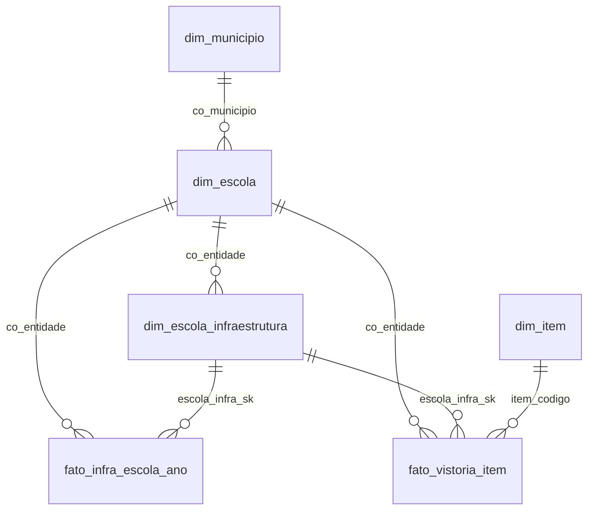

# Modelo analítico (Gold)

A Gold responde à pergunta de gestão do projeto: a infraestrutura de uma escola
se reflete no desempenho dos seus alunos no ENEM? Esta página declara o grão de
cada tabela, a decisão de modelagem, as regras da dimensão de variação lenta e o
que ainda depende de outras entregas. O SQL fica em `src/eduinfra/modelo_analitico.py`,
em constantes, para poder ser movido sem mudanças para dbt ou SQLMesh quando o
ADR 0005 escolher a ferramenta.

## Como rodar

```bash
docker compose build carga
docker compose run --rm carga construir-gold
docker compose run --rm -v "${PWD}/docs:/app/docs" carga comparar-granularidades --saida docs/granularidades.md
```

O `build` vem primeiro: quem já tem a imagem antiga recebe `invalid choice` em
`construir-gold`, porque o comando é novo. O `-v` monta a pasta `docs/` no
contêiner (a imagem não a contém); sem ele o arquivo seria gravado dentro do
contêiner e perdido. No bash use `$(pwd)` no lugar de `${PWD}`.

`comparar-granularidades` mede os dois fatos abaixo; rode com a carga real e faça
o commit de `docs/granularidades.md`, que é a evidência do ADR 0005. Rode de novo
sempre que o desenho dos fatos mudar: os tamanhos e tempos dependem das colunas e
dos índices.

## Garantias da construção

- **Um retrato só da origem.** A construção roda numa transação `REPEATABLE READ`:
  se uma vistoria for confirmada no meio, nenhuma tabela da Gold a enxerga, e as
  tabelas ficam consistentes entre si. A vistoria entra na construção seguinte.
- **Independe do fuso.** A sessão usa UTC e a chave substituta é calculada sobre o
  instante em UTC; mudar o fuso do servidor não muda nenhuma chave.
- **Tudo ou nada.** O schema `gold` é recriado numa transação: quem consulta vê o
  modelo anterior completo ou o novo completo. Rodar duas vezes dá o mesmo resultado.

Limites conhecidos:

- Durante o `drop schema` e a recriação, leituras da Gold esperam o fim da transação.
- A construção grava bastante WAL, e o slot do CDC retém o WAL que o consumidor ainda
  não confirmou. Até o consumidor avançar em passadas vazias, **evite rodar
  `construir-gold` repetidas vezes num banco compartilhado**.

## Tabelas e grãos

| Tabela | Tipo | Grão (uma linha por...) |
| --- | --- | --- |
| `gold.dim_item` | dimensão, tipo 1 | item de infraestrutura do catálogo |
| `gold.dim_municipio` | dimensão, tipo 1 | município |
| `gold.dim_escola` | dimensão, tipo 1 | escola (atributos do Censo) |
| `gold.dim_escola_infraestrutura` | dimensão, **tipo 2** | escola, por intervalo em que o perfil de infraestrutura não mudou |
| `gold.fato_vistoria_item` | fato fino | escola, por item, por vistoria; aponta para a versão do perfil vigente no instante da vistoria, já com o efeito dela |
| `gold.fato_infra_escola_ano` | fato largo | escola, por ano civil em que houve vistoria, com o perfil vigente ao fim do ano |



## Decisão de modelagem: estrela, com o fato largo como consumo

O modelo é uma **estrela**: dimensões compartilhadas e dois fatos. A camada de
consumo (painel e consultas da pergunta de gestão) lê o fato largo. A tabela única
(*one big table*) foi descartada pelos motivos abaixo, e o ADR 0005 (#6) formaliza
a decisão e define os gatilhos de revisão.

- **Reuso das dimensões.** O fato de desempenho do ENEM tem de apontar para a mesma
  escola e, no tempo, para a mesma versão do perfil. Com tabela única, os atributos
  da escola e o perfil seriam copiados em cada linha de cada fato.
- **Regras de versionamento num lugar só.** A dimensão de variação lenta concentra
  o que é "uma mudança"; numa tabela única essas regras se espalhariam pelas cargas.
- **A medição pesa a favor do largo.** Com o Censo 2024 real, o fato fino tem 17x
  mais linhas e ocupa dezenas de vezes mais espaço que o largo, e as duas consultas
  da mesma pergunta dão resultado idêntico (números em `granularidades.md`).
- **O fino não é descartado.** Continua como detalhe auditável por vistoria e item,
  ligado à versão do perfil; serve às perguntas que o largo não responde.

Revisar a decisão se surgir pergunta que precise de item por instante no grão do
evento como caminho principal, ou se o fato largo deixar de caber nas consultas.

## Dimensão de variação lenta: `dim_escola_infraestrutura`

Cada versão é o perfil de infraestrutura de uma escola durante um intervalo
`[valid_from, valid_to)`. A versão atual tem `valid_to = 'infinity'` e
`is_current = true`.

| Coluna | Significado |
| --- | --- |
| `escola_infra_sk` | chave substituta da versão: hash de `(co_entidade, valid_from em UTC)` |
| `co_entidade` | escola |
| `valid_from`, `valid_to` | intervalo de vigência, fechado no início e aberto no fim |
| `is_current` | `true` na versão mais recente da escola |
| `vistoria_origem_id` | vistoria que originou a versão |
| `n_itens_conhecidos` | itens com situação conhecida nesta versão |
| `n_existentes`, `n_inexistentes`, `n_em_obra`, `n_inutilizaveis` | contagens por situação |
| `itens` | JSON `item -> situação` |
| `quantidades` | JSON `item -> quantidade`, só dos itens com quantidade conhecida |

### Regras

- **Uma versão nova nasce quando algum item muda** de situação ou de quantidade.
  Uma vistoria que repete o estado anterior não cria versão.
- **`nao_informado` não é estado.** Não cria versão nem apaga o que já se sabia
  do item. É a mesma regra da view `escola_estado_atual` da origem.
- **Quantidade não informada não apaga a conhecida.** Dentro de um trecho de mesma
  situação, uma revisita sem quantidade mantém a última quantidade informada e não
  cria versão. Depois que a situação muda, a quantidade antiga não volta.
- **Empate no mesmo instante** desempata pelo id da vistoria, nos dois fatos e na
  dimensão; duas vistorias do mesmo dia valem pela ordem em que ocorreram.
- **O histórico vem dos eventos insert-only** (`ocorrido_em` da vistoria), não de
  um segundo ano do Censo. Os atributos de `dim_escola` vêm de um único ano e por
  isso não têm histórico a guardar ainda.

### Exemplo

Vistorias da escola 53000001:

| `ocorrido_em` | Origem | Laboratório de ciências | Biblioteca | Internet |
| --- | --- | --- | --- | --- |
| 29/05/2024 | Censo | inexistente | existente | não informado |
| 10/03/2025 | presencial | existente (quantidade 2) | existente | não informado |
| 01/06/2025 | presencial | existente (sem quantidade) | existente | não informado |

Versões resultantes:

| `valid_from` | `valid_to` | `is_current` | Laboratório | Quantidade | Biblioteca | Internet |
| --- | --- | --- | --- | --- | --- | --- |
| 29/05/2024 | 10/03/2025 | não | inexistente | | existente | desconhecida |
| 10/03/2025 | infinity | sim | existente | 2 | existente | desconhecida |

A vistoria de 01/06/2025 não cria versão: repete a situação e não informa a
quantidade, então a de 2 continua valendo. Internet segue desconhecida, porque
nenhuma vistoria disse algo sobre ela.

### Chaves e eventos atrasados

A chave de uma versão é função de `(co_entidade, valid_from)`. Reconstruir a
dimensão depois de um evento atrasado tem dois desfechos:

- Se o evento **muda o estado** (por exemplo, uma vistoria de janeiro de 2024 que
  encontrou o laboratório existente), ele cria uma versão nova no início e as
  versões que já existiam mantêm a chave e o início.
- Se o evento **repete o estado** da versão seguinte, as duas se fundem: a versão
  passa a começar na data do evento atrasado e a **chave antiga deixa de existir**.
  Isso é inerente a derivar a chave do início.

Em nenhum dos casos uma chave passa a apontar para outra versão: ou ela segue
apontando para a mesma, ou deixa de existir. Como a Gold é reconstruída inteira, os
fatos são reconstruídos junto e não ficam com chave pendente; quem guardar chaves
fora da Gold deve tratá-las como válidas só até a próxima construção.

Consulta de um dia específico (ponto no tempo):

```sql
select itens ->> 'lab_ciencias'
from gold.dim_escola_infraestrutura
where co_entidade = 53000001
  and valid_from <= '2025-04-01' and '2025-04-01' < valid_to;
```

## Duas granularidades

O fato **fino** é o evento: preserva tudo, mas responder "como a escola estava no
ano X" exige escolher a última vistoria de cada escola e não herda o estado de
anos anteriores. O fato **largo** guarda o perfil do ano, herdado pela dimensão
de variação lenta, com um item por coluna. `comparar-granularidades` roda a mesma
pergunta nos dois (% de escolas com laboratório de ciências por UF e rede, no ano
de maior cobertura) e confere se as respostas são iguais. Se divergirem, o comando
avisa; a herança entre anos é uma causa possível, mas não a única.

## O que ainda depende de outras entregas

- **ENEM.** O fato de desempenho ainda não existe, porque o ENEM ainda não foi
  ingerido. Interface esperada: `fato_desempenho_escola_ano`, com uma linha por
  escola por ano do ENEM, chave `(co_entidade, ano)`. Para saber se a escola tinha
  laboratório **na época da prova**, a junção correta é pelo ponto no tempo:
  `d.valid_from <= data_da_prova and data_da_prova < d.valid_to`.
- **Fonte de eventos única.** Decidida no
  [ADR 0008](adr/0008-fonte-canonica-de-eventos.md): a Gold copia uma versão da
  tabela Delta `warehouse/eventos_vistoria` para `fonte.eventos_vistoria`, confere
  com a origem e lê só essa cópia nos três pontos de eventos: `stg_mudanca_item`
  (de onde sai a dimensão de variação lenta), o fato fino e os anos do fato largo.
  Vistoria sem item não é evento e não cria ano no fato largo.
- **Histórico real só cresce com o tempo.** Com apenas a carga do Censo, cada
  escola tem uma versão. Versões novas aparecem conforme as vistorias presenciais
  chegam.
