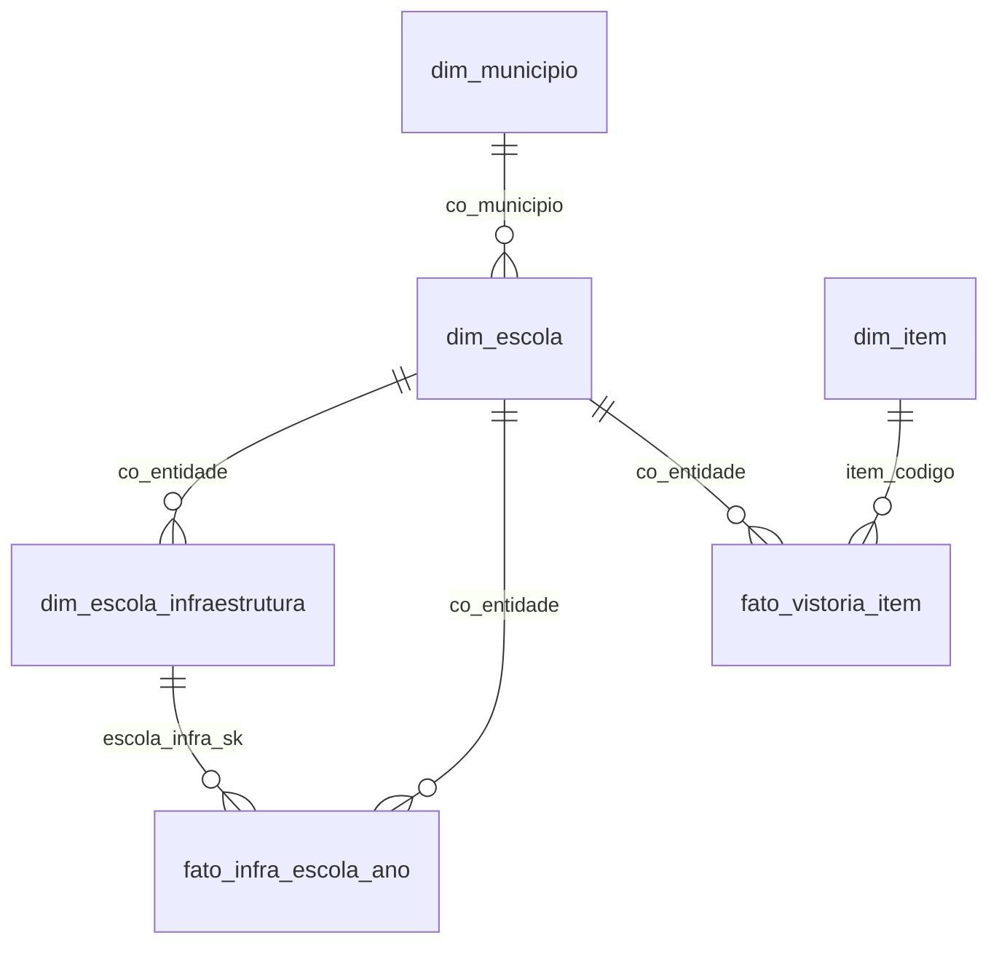

# Modelo analítico (Gold)

A Gold responde à pergunta de gestão do projeto: a infraestrutura de uma escola
se reflete no desempenho dos seus alunos no ENEM? Esta página declara o grão de
cada tabela, as regras da dimensão de variação lenta e o que ainda depende de
outras entregas. O SQL fica em `src/eduinfra/modelo_analitico.py`, em constantes,
para poder ser movido sem mudanças para dbt ou SQLMesh quando o ADR 0005 escolher
a ferramenta.

## Como rodar

```bash
docker compose run --rm carga construir-gold
docker compose build carga
docker compose run --rm -v "${PWD}/docs:/app/docs" carga comparar-granularidades --saida docs/granularidades.md
```

`construir-gold` recria o schema `gold` inteiro numa única transação: quem consulta
vê o modelo anterior completo ou o novo completo. Rodar duas vezes dá o mesmo
resultado. `comparar-granularidades` mede os dois fatos abaixo; rode com a carga
real e faça o commit de `docs/granularidades.md`, que é a evidência do ADR 0005.
O `-v` monta a pasta `docs/` no contêiner (a imagem não a contém); sem ele o
arquivo seria gravado dentro do contêiner e perdido. No bash use `$(pwd)` no lugar de `${PWD}`.

## Tabelas e grãos

| Tabela | Tipo | Grão (uma linha por...) |
| --- | --- | --- |
| `gold.dim_item` | dimensão, tipo 1 | item de infraestrutura do catálogo |
| `gold.dim_municipio` | dimensão, tipo 1 | município |
| `gold.dim_escola` | dimensão, tipo 1 | escola (atributos do Censo) |
| `gold.dim_escola_infraestrutura` | dimensão, **tipo 2** | escola, por intervalo em que o perfil de infraestrutura não mudou |
| `gold.fato_vistoria_item` | fato fino | escola, por item, por vistoria |
| `gold.fato_infra_escola_ano` | fato largo | escola, por ano civil em que houve vistoria, com o perfil vigente ao fim do ano |



## Dimensão de variação lenta: `dim_escola_infraestrutura`

Cada versão é o perfil de infraestrutura de uma escola durante um intervalo
`[valid_from, valid_to)`. A versão atual tem `valid_to = 'infinity'` e
`is_current = true`.

Regras:

- **Uma versão nova nasce quando algum item muda** de situação ou de quantidade.
  Uma vistoria que repete o estado anterior não cria versão.
- **`nao_informado` não é estado.** Não cria versão nem apaga o que já se sabia
  do item. É a mesma regra da view `escola_estado_atual` da origem, e um teste
  confere os dois contra o mesmo dado.
- **O histórico vem dos eventos insert-only** (`ocorrido_em` da vistoria), não de
  um segundo ano do Censo. Os atributos de `dim_escola` vêm de um único ano e por
  isso não têm histórico a guardar ainda.
- **A chave substituta é função de `(co_entidade, valid_from)`.** Um evento
  atrasado, com `ocorrido_em` no passado, muda o histórico da escola ao reconstruir,
  mas as chaves das versões que já existiam continuam apontando para a mesma versão.
- Cada versão guarda `itens` (item para situação), `quantidades`, contagens por
  situação e `vistoria_origem_id`, a vistoria que a originou.

Consulta de um dia específico (ponto no tempo):

```sql
select itens ->> 'lab_ciencias'
from gold.dim_escola_infraestrutura
where co_entidade = 53000001
  and valid_from <= '2025-04-01' and '2025-04-01' < valid_to;
```

## Duas granularidades

O fato **fino** é o evento: preserva tudo, mas responder "como a escola estava no
ano X" exige escolher a última vistoria de cada escola e não herda o estado de
anos anteriores. O fato **largo** guarda o perfil do ano, herdado pela dimensão
de variação lenta, com um item por coluna. `comparar-granularidades` roda a mesma
pergunta nos dois (% de escolas com laboratório de ciências por UF e rede, no ano
de maior cobertura) e confere se as respostas são iguais.

A escolha final é do ADR 0005, com a medição feita sobre a carga real. Em dados
sintéticos do mesmo volume do Censo (181 mil escolas), o fino teve cerca de 15
vezes mais linhas e consulta várias vezes mais lenta que o largo, com resposta
idêntica; isso só indica a ordem de grandeza, não substitui a medição real.

## O que ainda depende de outras entregas

- **ENEM.** O fato de desempenho ainda não existe, porque o ENEM ainda não foi
  ingerido. Interface esperada: `fato_desempenho_escola_ano`, com uma linha por
  escola por ano do ENEM, chave `(co_entidade, ano)`. Para saber se a escola tinha
  laboratório **na época da prova**, a junção correta é pelo ponto no tempo:
  `d.valid_from <= data_da_prova and data_da_prova < d.valid_to`.
- **Fonte de eventos única.** A Gold lê as tabelas da origem (`public.vistoria` e
  `public.vistoria_item`). Quando a unificação dos caminhos de dado atrasado
  decidir a fonte canônica, só o bloco de staging (`stg_mudanca_item`) muda.
- **Histórico real só cresce com o tempo.** Com apenas a carga do Censo, cada
  escola tem uma versão. Versões novas aparecem conforme as vistorias presenciais
  chegam.
