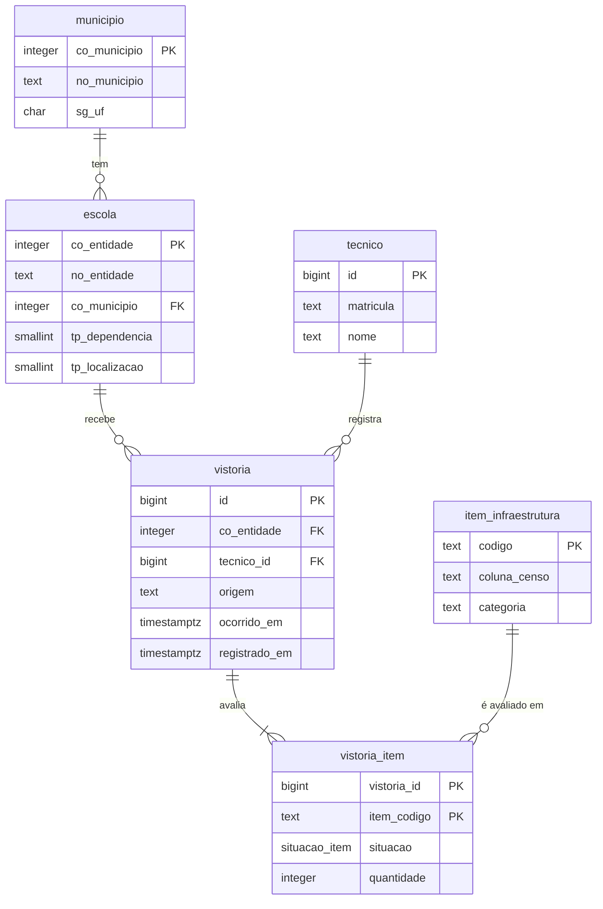

# Modelo da origem

O PostgreSQL mantém os cadastros e o histórico das vistorias. O aplicativo é
previsto como produtor desses eventos; a carga do Censo cria a linha de base.

- `escola` e `municipio` são cadastro: vêm do Censo e só aceitam correção.
- `vistoria` e `vistoria_item` são eventos: só aceitam `INSERT`. Uma mudança na
  escola é uma vistoria nova, não a edição da anterior.
- `situacao` é um de `existente`, `inexistente`, `em_obra`, `inutilizavel` ou
  `nao_informado`. Um item não informado não apaga o que a vistoria anterior
  disse.
- `tecnico` é o único lugar com dado pessoal.
- A view `escola_estado_atual` pega, para cada escola e item, o evento mais
  recente.

## Histórico e datas

`ocorrido_em` registra quando a situação foi observada; `registrado_em` registra
quando ela entrou no banco. Uma vistoria digitada depois continua pertencendo
à data em que ocorreu.

Gatilhos bloqueiam `UPDATE`, `DELETE` e `TRUNCATE` nas tabelas de eventos.
Retificações exigem novos registros. Essa regra não torna todos os cadastros
imutáveis: ela se aplica às vistorias e a seus itens.

A decisão e as medições comparativas com CRUD estão no
[ADR 0001](adr/0001-modelagem-insert-only-do-sistema-de-origem.md).
A [caracterização da carga](caracterizacao.md) reúne volumes, padrões de acesso
e estimativas de tráfego, separando-os dos resultados medidos.
