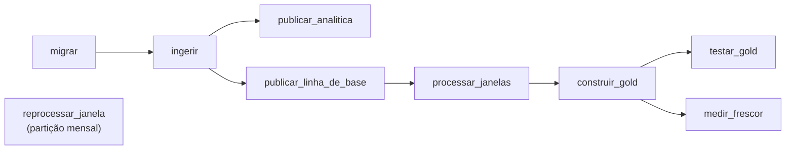

# Orquestração do pipeline em lote

## Dagster

O Dagster é uma ferramenta de orquestração de pipelines de dados escrita em
Python. Ele não processa os dados, ele apenas decide quando e em que ordem
cada etapa roda, tenta de novo quando uma etapa falha e guarda o histórico de
tudo que foi executado, que pode ser acompanhado por uma interface web.

## O que ele faz neste projeto

O Dagster roda o pipeline em lote chamando os comandos que já existiam na CLI
`eduinfra`, como `migrar`, `ingerir` e `processar-janelas`, e o script do dbt para a Gold. O código está em
[orquestrador.py](https://github.com/daviegito/bd2_2026_2_eduinfra/blob/main/src/eduinfra/orquestrador.py).



- **Ordem das etapas.** Cada etapa só roda depois que as anteriores terminam
  bem. Se uma falha, as seguintes não rodam.
- **Gold.** A Gold é construída pelo dbt, com o mesmo script do serviço
  `transformacao`, que também ingere o ENEM.
- **Testes de dados.** Depois da Gold, o `testar_gold` roda os testes de
  `tests/test_e3_gold.py`: esquema, volume, unicidade, integridade referencial,
  distribuição e domínio da situação. Ele não tem retry, porque um teste que falha
  aponta defeito na Gold, e repetir não corrige.
- **Frescor.** Depois da Gold, o `medir_frescor` falha se alguma vistoria
  estiver há mais de 25 horas sem aparecer nela.
- **Retry.** Cada etapa tem até 3 novas tentativas, com espera de 30, 90 e
  210 s entre elas. Isso cobre falhas passageiras, como o banco reiniciando.
- **Agendamento.** O pipeline roda sozinho no horário de `AGENDA_ORQUESTRADOR`
  do `.env`, que por padrão é todo dia às 3h. Cada execução reconstrói a Gold
  inteira. A agenda só dispara enquanto o serviço está no ar.
- **Backfill.** O `reprocessar_janela` reprocessa meses que já passaram. Pela
  interface dá para escolher vários meses, e o Dagster cria uma execução para
  cada um.

## Como rodar

O serviço `orquestrador` sobe junto com o resto do ambiente. Ele espera o CDC
estar no ar para o dbt construir a Gold

```bash
docker compose up --build
```

A interface fica em <http://localhost:3000>.

## Demonstrações

### Retry

1. Com o ambiente no ar, derrube o banco com `docker compose stop banco`.
2. Na interface, abra o job `pipeline` e clique em *Materialize all*.
3. Em *Runs*, o passo `migrar` falha e o log avisa que vai tentar de novo em
   30 segundos.
4. Religue o banco com `docker compose start banco`.
5. A tentativa seguinte passa e o pipeline vai até o fim.

### Backfill

1. Na interface, abra o asset `reprocessar_janela`.
2. Clique em *Materialize*, escolha os meses de 2024-01 a 2024-12 e lance o
   backfill.
3. Em *Runs*, na aba *Backfills*, aparece uma execução para cada mês.

### Agendamento

1. No `.env`, coloque `AGENDA_ORQUESTRADOR="*/5 * * * *"`, que roda a cada 5
   minutos.
2. Recrie o serviço com `docker compose up -d orquestrador`.
3. Depois de alguns minutos, as execuções disparadas pela agenda aparecem
   sozinhas em *Runs*.
4. Depois, volte para `"0 3 * * *"`, para a Gold não ser reconstruída a cada 5 minutos.

## Execuções registradas

O retry e o backfill foram executados pelo Dagster, com `dagster asset materialize`,
num PostgreSQL descartável com a amostra de `gerar_amostra --escolas 200` e 15
vistorias atrasadas inseridas em abril, maio e junho de 2024, cinco por mês, com três
itens cada.

| Demonstração | O que aconteceu | Registro |
| --- | --- | --- |
| Retry | Com o banco parado, `migrar` falhou ao conectar e o Dagster agendou nova tentativa em 30 s. O banco voltou 26 s depois de parado, a segunda tentativa passou e a execução terminou com `RUN_SUCCESS` | [retry.log](evidencias/orquestracao/retry.log) |
| Backfill | `reprocessar_janela` rodou para 2024-04, 2024-05 e 2024-06, uma execução por mês, e cada uma reconciliou 15 eventos. A fonte de eventos, que só tinha novembro de 2026, ficou com 15 eventos em cada um dos três meses | [backfill.log](evidencias/orquestracao/backfill.log) |

Pela CLI, um intervalo de partições só roda quando o asset tem política de execução
única, então cada mês foi lançado separadamente, como o backfill da interface faz, com
uma execução por partição. Essas execuções não passam pelo `construir_gold`, que
precisa do Censo completo e do CDC no ar. A construção pelo dbt tem os testes e as
medições de [Transformação declarativa](transformacao.md).

## Histórico de Versões

| Versão | Descrição | Autor | Revisão | Data |
| --- | --- | --- | --- | --- |
| 1.0 | Orquestração com Dagster: grafo, retry, agenda e backfill | [Lucas Mendonça Arruda](https://github.com/lucasarruda9) |  | 3 de novembro de 2026 |
| 1.1 | Inclui a Gold pelo dbt e o frescor no pipeline | [Lucas Mendonça Arruda](https://github.com/lucasarruda9) |  | 9 de novembro de 2026 |
| 1.2 | Inclui os testes de dados no pipeline e registra as execuções de retry e backfill | [Artur Mendonça Arruda](https://github.com/ArtyMend07) |  | 9 de novembro de 2026 |
