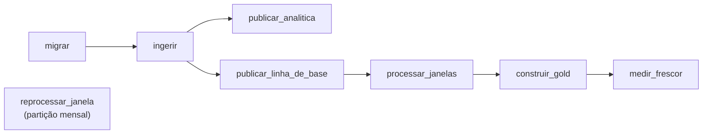

# Orquestração do pipeline em lote

## Dagster

O Dagster é uma ferramenta de orquestração de pipelines de dados escrita em
Python. Ele não processa os dados, ele apenas decide quando e em que ordem
cada etapa roda, tenta de novo quando uma etapa falha e guarda o histórico de
tudo que foi executado, que pode ser acompanhado por uma interface web.

## O que ele faz neste projeto

O Dagster roda o pipeline em lote chamando os comandos que já existiam na CLI
`eduinfra`, como `migrar`, `ingerir` e `construir-gold`. O código está em
[orquestrador.py](https://github.com/daviegito/bd2_2026_2_eduinfra/blob/main/src/eduinfra/orquestrador.py).



- **Ordem das etapas.** Cada etapa só roda depois que as anteriores terminam
  bem. Se uma falha, as seguintes não rodam.
- **Gold.** A Gold lê a tabela de eventos das vistorias. Por isso o pipeline
  atualiza essa tabela antes de reconstruir a Gold.
- **Frescor.** Depois da Gold, o `medir_frescor` falha se alguma vistoria
  estiver há mais de 25 horas sem aparecer nela.
- **Retry.** Cada etapa tem até 3 novas tentativas, com espera de 30, 90 e
  210 s entre elas. Isso cobre falhas passageiras, como o banco reiniciando.
- **Agendamento.** O pipeline roda sozinho no horário de `AGENDA_ORQUESTRADOR`
  do `.env`, que por padrão é todo dia às 3h. Cada execução reconstrói a Gold
  inteira. A agenda só dispara enquanto o serviço está no ar.
- **Backfill.** O `reprocessar_janela` reprocessa meses que já passaram. Pela
  interface dá para escolher vários meses, e o Dagster cria uma execução para
  cada um.

## Como rodar

O serviço `orquestrador` sobe junto com o resto do ambiente.

```bash
docker compose up --build
```

A interface fica em <http://localhost:3000>.

## Demonstrações

### Retry

1. Com o ambiente no ar, derrube o banco com `docker compose stop banco`.
2. Na interface, abra o job `pipeline` e clique em *Materialize all*.
3. Em *Runs*, o passo `migrar` falha e o log avisa que vai tentar de novo em
   30 segundos.
4. Religue o banco com `docker compose start banco`.
5. A tentativa seguinte passa e o pipeline vai até o fim.

### Backfill

1. Na interface, abra o asset `reprocessar_janela`.
2. Clique em *Materialize*, escolha os meses de 2024-01 a 2024-12 e lance o
   backfill.
3. Em *Runs*, na aba *Backfills*, aparece uma execução para cada mês.

### Agendamento

1. No `.env`, coloque `AGENDA_ORQUESTRADOR="*/5 * * * *"`, que roda a cada 5
   minutos.
2. Recrie o serviço com `docker compose up -d orquestrador`.
3. Depois de alguns minutos, as execuções disparadas pela agenda aparecem
   sozinhas em *Runs*.
4. Depois, volte para `"0 3 * * *"`. para evitar que a Gold seja construída toda vez a cada 5 minutos.
