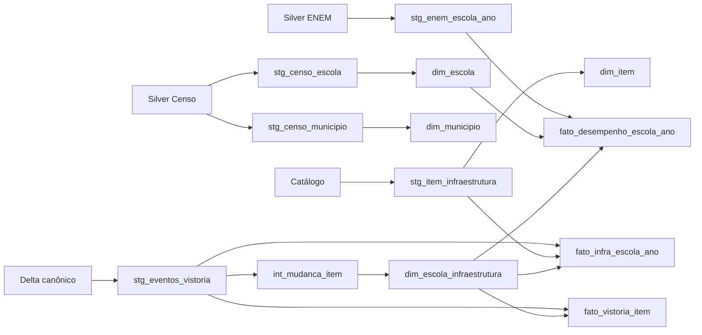

# Transformações declarativas da Gold — issue #48

O projeto `transformacao/` implementa em dbt a escolha do [ADR 0005](adr/0005-ferramenta-de-transformacao.md).
A Gold continua no PostgreSQL, com os seis marts de infraestrutura e o fato de
desempenho do ENEM. Staging, intermediate e marts ficam versionados no repositório.

## Um comando, inclusive num ambiente novo

Copie `.env.example` para `.env`, escolha as credenciais locais e execute:

```bash
docker compose run --build --rm transformacao
```

O Compose sobe o PostgreSQL, executa a carga do Censo e a publicação da fonte
canônica, inicia o CDC e espera seu healthcheck. O runner então ingere o ENEM
2024 pelo protocolo da #44, prepara as sources, executa `dbt build`, registra
o frescor da Gold e gera `dbt docs generate`. A primeira execução baixa os
pacotes oficiais; as seguintes reutilizam a Bronze e o manifesto por fonte/ano.
O comando só retorna sucesso se os modelos, os testes e a documentação terminarem.

O Censo, o ENEM e os eventos precisam estar presentes no fluxo completo. O
runner usa `warehouse/eventos_vistoria`, a fonte Delta canônica do
[ADR 0008](adr/0008-fonte-canonica-de-eventos.md). Não junta novamente os dois
produtores de eventos nem usa as antigas partições de eventos Parquet.

A execução parcial é explícita e não constitui o aceite completo da #48:

```bash
docker compose run --rm transformacao --somente-infraestrutura
```

Se a Gold já tem desempenho, esse modo falha para não manter um fato antigo
aparentando estar atualizado. `--exigir-enem` é mantido por compatibilidade;
o comando padrão já exige o ENEM. `--somente-documentacao` regenera o grafo do
retrato publicado, sem ingerir ou reconstruir dados.

## Fontes e contratos

O schema `entrada_transformacao` é uma cópia de trabalho reconstruível, com tabelas
UNLOGGED, chaves e checks. Uma transação `REPEATABLE READ` publica todas as entradas
ou restaura o retrato anterior em caso de erro. As views de staging dependentes
são recriadas pelo dbt; os marts materializados não são removidos no preparo.

| Source dbt | Produtor | Grão |
| --- | --- | --- |
| `analitico.censo_escola` | `silver/ano_censo=AAAA/escola.parquet` | último cadastro por escola |
| `analitico.censo_municipio` | `silver/ano_censo=AAAA/municipio.parquet` | município |
| `analitico.item_infraestrutura` | catálogo versionado das migrações | item de infraestrutura |
| `analitico.eventos_vistoria` | `warehouse/eventos_vistoria`, Delta | `(vistoria_id, item_codigo)` |
| `analitico.enem_escola_ano` | `silver/enem/ano=2024/desempenho_escola.parquet` | `(co_entidade, ano)` |

A versão Delta é fixada antes de iniciar o snapshot PostgreSQL e registrada no resumo;
um evento confirmado durante o preparo fica para a execução seguinte, sem falso alarme de origem. Os marcadores
`origem.sha256` das Silver são conferidos antes e depois do preparo. O catálogo é
metadado: os modelos dbt não consultam eventos em `public`. A origem é consultada
no preparo para recusar chaves de eventos inexistentes, como na construção SQL.
Uma fonte incompleta pode gerar Gold incompleta; o frescor continua apontando o atraso.

O bloqueio de sessão serializa preparo, build e docs. Todas as execuções devem
usar o runner; chamar dbt manualmente não adquire esse bloqueio. A publicação das
sources é atômica, mas o dbt materializa modelos em transações separadas. Uma
falha no build precisa ser corrigida e reexecutada antes de servir a Gold como
atualizada; não há promessa de atomicidade da Gold inteira.

### ENEM real, sem alterar a Silver

O consumidor adapta os nomes publicados pelo produtor:

| Silver ENEM | Source da transformação |
| --- | --- |
| `co_escola` | `co_entidade` |
| `participantes` | `n_participantes` |
| `participantes_sem_nota_valida` | `n_participantes_sem_nota` |
| `participantes_com_todas_as_notas` | `n_participantes_com_todas_as_notas` |
| `media_*`, `notas_validas_*`, `media_geral`, `redacoes_nota_zero`, `poucos_participantes` | preservados |

A transformação não recalcula as médias nem muda os critérios de ausentes,
notas faltantes ou zero; eles são os declarados pelo produtor em [ENEM](enem.md).
Não há corte adicional em 30 participantes. Todas as escolas da Silver ficam
na entrada. O fato de desempenho inclui somente as escolas cuja chave existe
na dimensão do Censo. O resumo registra total, encontradas, sem correspondência,
poucos participantes sem correspondência e os respectivos participantes. Assim,
as escolas mascaradas não viram escolas fictícias na dimensão e a exclusão fica
mensurável. Ausência de correspondência não é substituída por nota zero.

A referência temporal é uma decisão da análise, não um campo do microdado:

```dotenv
DATA_REFERENCIA_ENEM=2024-11-03
```

Usamos **03/11/2024 às 00:00 UTC** como ponto de corte explícito da infraestrutura,
o início do primeiro dia regular. O [Inep](https://www.gov.br/inep/pt-br/relatorio-anual-de-atividades-e-gestao-do-inep-2024/avaliacoes-e-exames-educacionais/avaliacoes-exames-nacionais/enem)
registra as aplicações regulares em 3 e 10 de novembro. O campo
`data_referencia_infraestrutura` não pretende representar o horário ou a data
individual de aplicação de cada participante, incluindo reaplicações.
A referência pode ser parametrizada e deve pertencer ao mesmo ano dos dados.

O fato liga a SCD por `valid_from <= referência < valid_to`, para não associar a
nota de 2024 a uma reforma de 2025. Uma escola sem estado conhecido na referência
mantém `escola_infra_sk` nula; não se inventa infraestrutura para ela.

`FONTE_ENEM` permite selecionar outro arquivo ou diretório com
`desempenho_escola.parquet` no mesmo contrato. Um caminho configurado e ausente
falha; não é transformado em tabela vazia. Sem override, a ingestão padrão produz
a partição de `ANO_ENEM`, usando `URL_ENEM` e o manifesto existente.
`FONTE_EVENTOS` existe para entradas controladas de testes; o fluxo padrão usa a
fonte Delta canônica e fixa a versão, sem varrer arquivos físicos do log.

## Camadas e grafo

- **Staging (`stg_*`):** views das sources tipadas.
- **Intermediate (`int_*`):** mudanças de situação/quantidade por escola/item e
  intervalos de vigência; `nao_informado` e quantidade ausente não apagam conhecimento.
- **Marts:** dimensões de item, município, escola e infraestrutura SCD2; fatos
  `fato_vistoria_item`, `fato_infra_escola_ano` e `fato_desempenho_escola_ano`.



O grafo executável está no `manifest.json`; `index.html` e `catalog.json` são
produzidos por `dbt docs generate` em `/dados/dbt`. Como `transformacao` usa `run --rm`, exporte a documentação interativa do volume
por um contêiner temporário:

```bash
docker compose run --rm --no-deps --entrypoint sh \
  -v "$PWD/dbt-docs:/saida" transformacao -c 'cp -a /dados/dbt/. /saida/'
python -m http.server 8080 --directory dbt-docs
```

Abra `http://localhost:8080` e selecione o grafo no dbt Docs. Os artefatos gerados
não são versionados; o diagrama acima e os testes do manifesto registram a linhagem.

## Comparação com a opção nula

A [medição reproduzível](evidencias/issue-48/comparacao.md) compara as mesmas seis
tabelas de infraestrutura em SQL direto e dbt, com fontes paradas e `EXCEPT ALL`
nos dois sentidos, em todas as colunas. O ENEM é validado separadamente no fluxo
completo e nos testes; não participa desse benchmark de infraestrutura.

Cada amostra inclui o próprio preparo de fontes, além da construção. `dbt build`
inclui os testes declarativos; `dbt run` permite distinguir esse custo. O contador
de SQL exclui comentários/linhas vazias e não representa, sozinho, manutenção ou
simplicidade. Os resultados complementam o ADR 0005, sem repetir SQLMesh.

## CDC, painel e validação

O runner verifica a retenção finita e o dreno recente antes de escrever o retrato.
Com slot, exige o consumidor da #60 ativo, margem de WAL e pelo menos 2 GB de
retenção. Não avança slots desconhecidos. O preparo UNLOGGED reduz WAL; a Gold
continua persistente. Os contratos das seis tabelas de infraestrutura são mantidos
para consulta, painel e frescor. O runner registra `monitoramento.frescor_gold`
após o build em `gold`; uma execução em outro schema não registra frescor da Gold.

Os testes da #48 cobrem igualdade com SQL, reexecução, fonte Delta, rejeição de
chaves estranhas/duplicadas, rollback das entradas, contrato real do produtor ENEM,
cobertura, referência parametrizada, histórico SCD2, grafo e defeito de vigência
injetado. O aceite com dados reais e a saúde do CDC ficam nas
[evidências](evidencias/issue-48/comparacao.md).

| Checklist / aceite | Implementação e evidência |
| --- | --- |
| Opção nula versus declarativa | benchmark com tempo, SQL, testes, linhagem e igualdade exata |
| Projeto e perfil Compose | `transformacao/dbt_project.yml` e `profiles.yml` |
| Sources Censo, ENEM e eventos | contrato real da Silver, versão Delta e catálogo |
| Camadas e nomes | staging, intermediate, marts; `stg_*`, `int_*`, dimensões/fatos |
| Serviço e comando único | serviço `transformacao` e fluxo padrão completo |
| Grafo visível | diagrama acima, dbt Docs, catálogo e manifesto |
| Clone limpo e comparação salva | execução isolada e medição nas evidências |
